# Sistema de Gestión de Biblioteca

**Documentación técnica de base de datos, diagramas UML y diseño de backend Java / Spring Boot**  
**Fuente de verdad:** archivo `bd_biblioteca_completa.sql` (MySQL 8.0).  
**Convención:** **[SQL]** significa dato existente en el archivo; **[PROPUESTA]** significa diseño sugerido para el backend, no presente en SQL.

## 1. Objetivo y alcance

Construir una API REST para mantener categorías, libros, lectores, roles y usuarios; registrar préstamos y devoluciones; administrar existencias disponibles; y controlar acceso según rol. El archivo SQL solo define esquema, restricciones básicas y datos de ejemplo; **no contiene controladores, API, procedimientos, disparadores, reglas de préstamos ni esquema de seguridad**.

### 1.1 Inventario verificado [SQL]

| Tabla | PK | FK | Campos únicos | Descripción |
|---|---|---|---|---|
| `categorias` | `id_categoria` | — | `nombre` | Catálogo de categorías |
| `libros` | `id_libro` | `id_categoria` | `isbn` | Libros y número de ejemplares disponibles |
| `lectores` | `id_lector` | — | `dni`, `email` | Lectores; estado ACTIVO/SANCIONADO |
| `roles` | `id_rol` | — | `nombre` | ADMINISTRADOR, BIBLIOTECARIO en datos de ejemplo |
| `usuarios` | `id_usuario` | `id_rol` | `email` | Operadores del sistema |
| `prestamos` | `id_prestamo` | `id_lector`, `id_libro`, `id_usuario` | — | Historial de préstamos |

Los seis identificadores primarios son `INT NOT NULL AUTO_INCREMENT`. Todas las cinco FK son obligatorias. La BD no especifica `ON DELETE`/`ON UPDATE` explícitos. Las relaciones desde las entidades padre son `1 a 0..N`, y cada hijo exige exactamente un padre para la FK relevante.

### 1.2 Diccionario de datos [SQL]

| Tabla | Columna | MySQL | Obligatorio | Regla / predeterminado |
|---|---|---|---|---|
| categorias | id_categoria | INT | Sí | PK autoincremental |
| categorias | nombre | VARCHAR(100) | Sí | UNIQUE |
| categorias | descripcion | VARCHAR(255) | No | NULL |
| libros | id_libro | INT | Sí | PK autoincremental |
| libros | isbn | VARCHAR(20) | Sí | UNIQUE |
| libros | titulo | VARCHAR(200) | Sí | — |
| libros | autor | VARCHAR(150) | Sí | — |
| libros | ejemplares_disponibles | INT | Sí | DEFAULT 1; **sin CHECK de no negatividad** |
| libros | id_categoria | INT | Sí | FK → categorias |
| lectores | id_lector | INT | Sí | PK autoincremental |
| lectores | dni | VARCHAR(15) | Sí | UNIQUE |
| lectores | nombre | VARCHAR(100) | Sí | — |
| lectores | apellido | VARCHAR(100) | Sí | — |
| lectores | email | VARCHAR(100) | Sí | UNIQUE |
| lectores | telefono | VARCHAR(20) | No | NULL |
| lectores | estado | ENUM | No | ACTIVO / SANCIONADO; DEFAULT ACTIVO |
| roles | id_rol | INT | Sí | PK autoincremental |
| roles | nombre | VARCHAR(50) | Sí | UNIQUE |
| usuarios | id_usuario | INT | Sí | PK autoincremental |
| usuarios | nombre | VARCHAR(100) | Sí | — |
| usuarios | apellido | VARCHAR(100) | Sí | — |
| usuarios | email | VARCHAR(100) | Sí | UNIQUE |
| usuarios | password | VARCHAR(255) | Sí | —; muestra contiene texto plano inseguro |
| usuarios | id_rol | INT | Sí | FK → roles |
| prestamos | id_prestamo | INT | Sí | PK autoincremental |
| prestamos | id_lector | INT | Sí | FK → lectores |
| prestamos | id_libro | INT | Sí | FK → libros |
| prestamos | id_usuario | INT | Sí | FK → usuarios |
| prestamos | fecha_prestamo | DATE | Sí | — |
| prestamos | fecha_devolucion_pactada | DATE | Sí | — |
| prestamos | fecha_devolucion_real | DATE | No | NULL |
| prestamos | estado | ENUM | No | PENDIENTE / DEVUELTO; DEFAULT PENDIENTE |

## 2. ERD · modelo físico relacional [SQL]

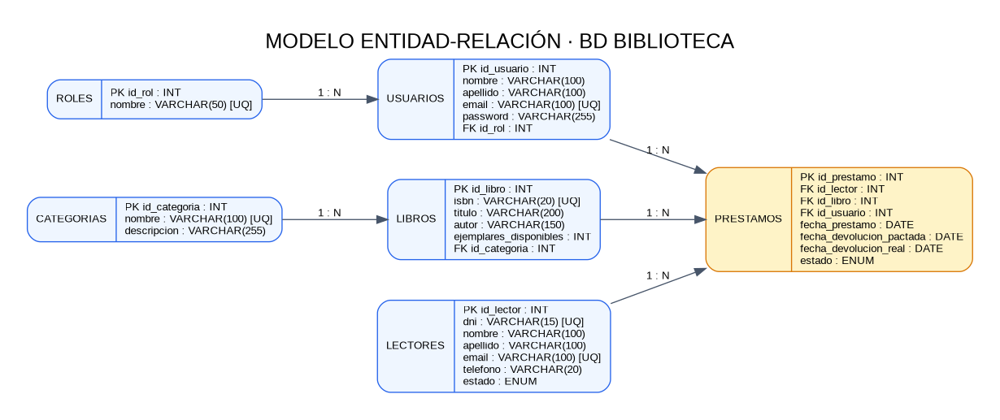

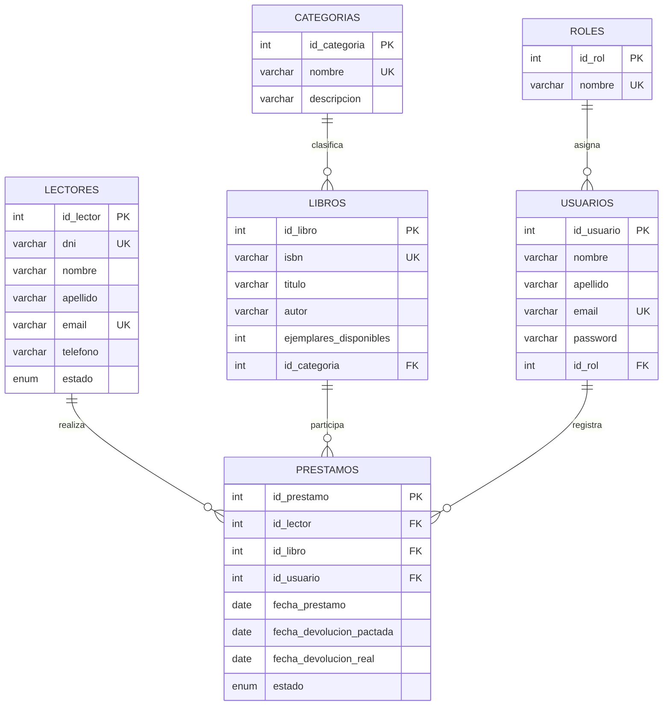

**Lectura:** un libro puede tener varios registros históricos de préstamo; cada préstamo se refiere a **un libro**. Esto **no** constituye un esquema maestro-detalle con varios libros dentro de un único préstamo. Para ese caso se necesitarían tablas como `prestamos_cabecera` y `prestamos_detalle` [PROPUESTA ALTERNATIVA, no implementada].

## 3. Diagrama UML de clases · entidades JPA [PROPUESTA]

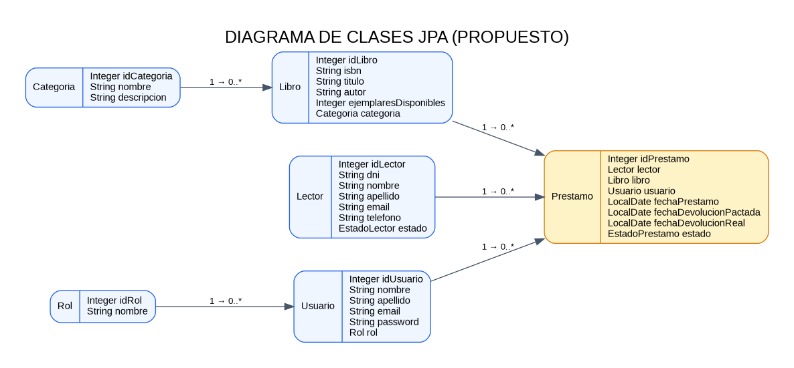

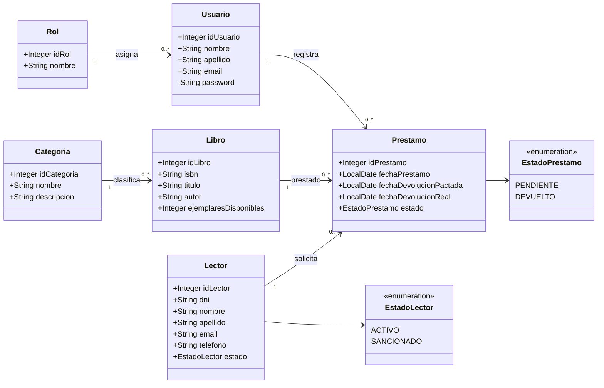

**Mapeo recomendado:** `@Entity`, `@Table`, `@Id`, `@GeneratedValue(strategy = GenerationType.IDENTITY)`, `@Column`, `@Enumerated(EnumType.STRING)` y `@ManyToOne(fetch = FetchType.LAZY)` con `@JoinColumn` para las cinco FK. `@OneToMany(mappedBy=...)` es opcional: comenzar con referencias unidireccionales desde hijos evita ciclos JSON y cargas innecesarias. Los campos `DATE` se representan con `LocalDate`; `INT` con `Integer`. **No exponer entidades directamente en el contrato REST: usar DTOs**.

## 4. Arquitectura de solución [PROPUESTA]

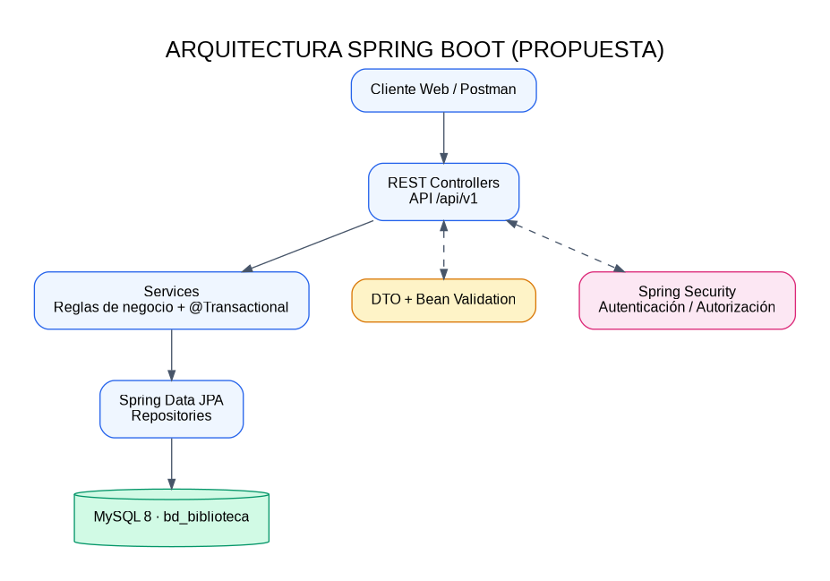

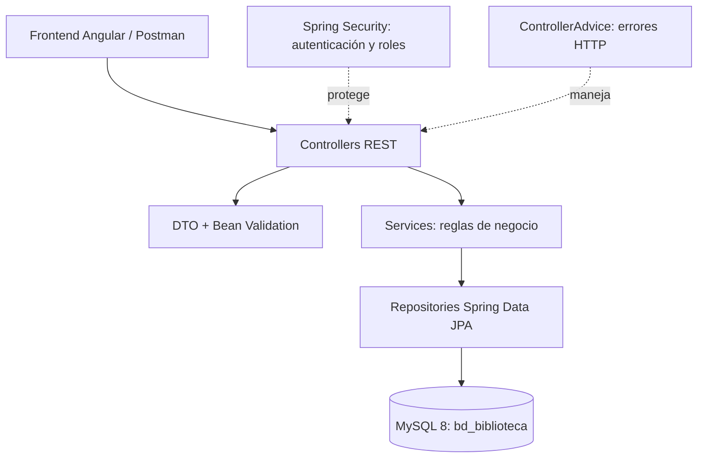

**Dependencias sugeridas:** Spring Web, Spring Data JPA, Validation, MySQL Connector/J, Spring Security, Actuator (opcional), Flyway (recomendado), springdoc-openapi (compatible con la versión elegida de Spring Boot) y Spring Boot Test.

### 4.1 Paquetes

```text
src/main/java/com/ejemplo/biblioteca/
├── BibliotecaApplication.java
├── config/                 # OpenAPI, CORS, configuración
├── security/               # SecurityConfig, autenticación
├── controller/             # CategoriaController, LibroController,
│                           # LectorController, PrestamoController,
│                           # UsuarioController, RolController
├── dto/
│   ├── request/             # CrearPrestamoRequest, CrearLibroRequest...
│   └── response/            # PrestamoResponse, LibroResponse...
├── entity/                  # 6 entidades JPA + enumeraciones
├── repository/              # 6 interfaces JpaRepository
├── service/                 # interfaces de aplicación
├── service/impl/            # implementaciones transaccionales
├── exception/               # DomainException, GlobalExceptionHandler
└── mapper/                  # conversores entidad ↔ DTO
src/main/resources/
├── application.yml
└── db/migration/             # migraciones nuevas, si se adopta Flyway
src/test/java/.../           # pruebas de negocio, API e integración
```

## 5. Casos de uso [PROPUESTA]

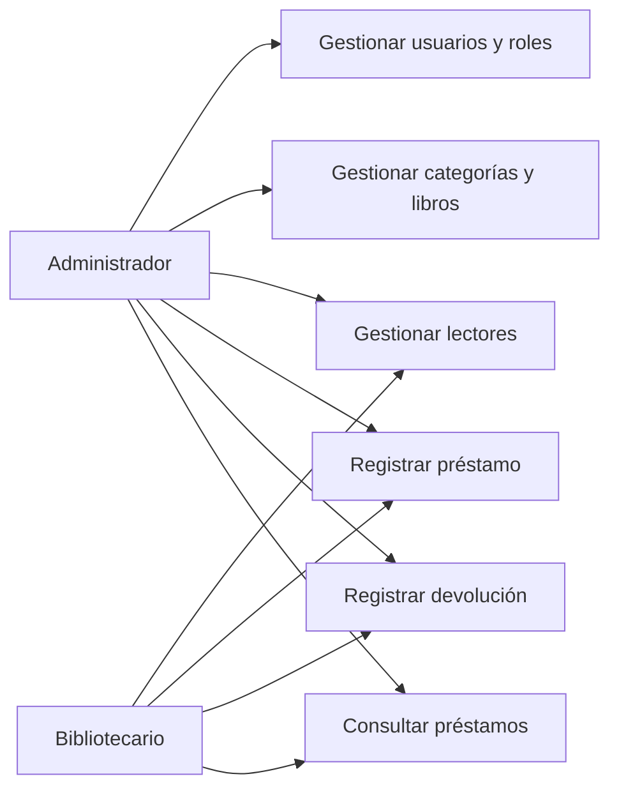

La base original **solo contiene** los nombres de roles `ADMINISTRADOR` y `BIBLIOTECARIO`; las facultades dibujadas son una política de acceso propuesta y deben aprobarse como reglas funcionales.

## 6. Secuencia: registrar préstamo [PROPUESTA]

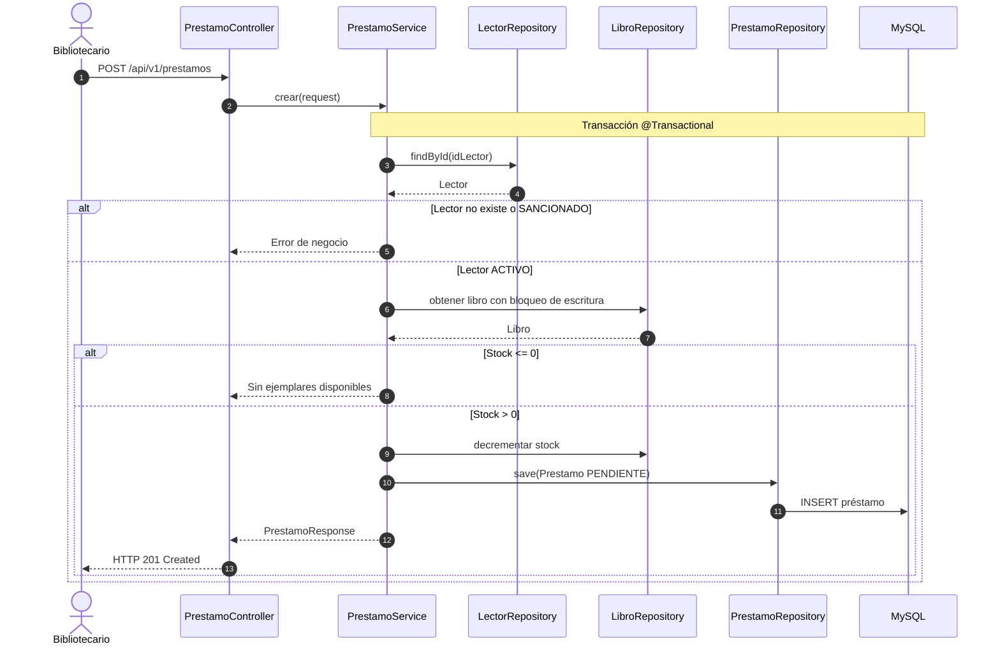

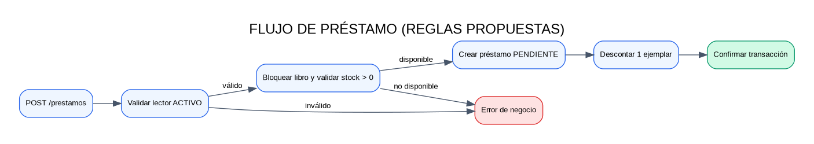

## 7. Secuencia: registrar devolución [PROPUESTA]

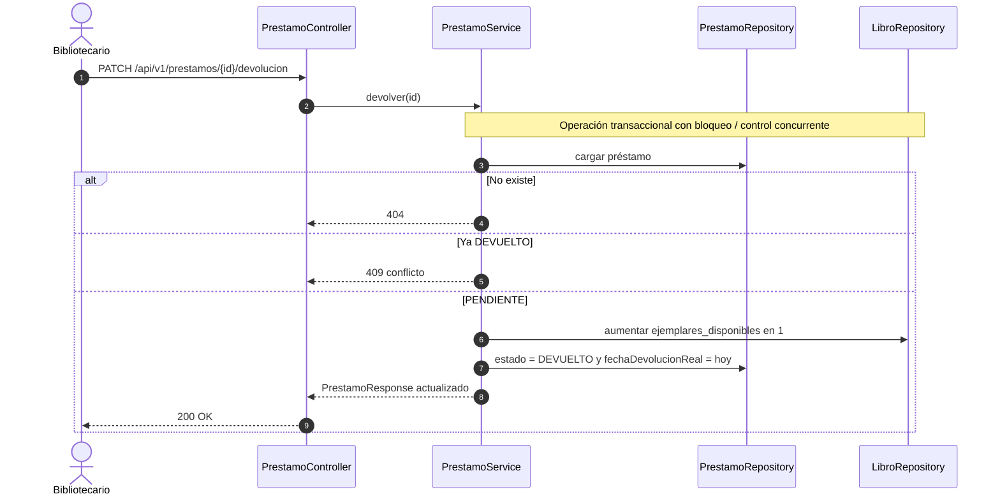

### 7.1 Estados

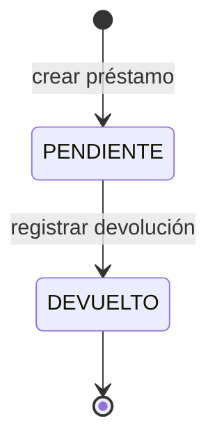

No hay estado `VENCIDO` en el ENUM SQL. Puede derivarse en consultas como `estado='PENDIENTE' AND fecha_devolucion_pactada < CURRENT_DATE()` sin modificar la columna. No hay estados `ANULADO` o `RENOVADO` en el modelo original.

## 8. Reglas de negocio: existentes frente a sugeridas

| Identificador | Regla | Origen | Implementación |
|---|---|---|---|
| RN-01 | ISBN único | [SQL] | Índice UNIQUE + capturar violación |
| RN-02 | DNI y email del lector únicos | [SQL] | Índices UNIQUE |
| RN-03 | Email de usuario único | [SQL] | Índice UNIQUE |
| RN-04 | Préstamo referencia lector, libro y usuario válidos | [SQL] | Tres FK obligatorias |
| RN-05 | Solo lectores ACTIVO pueden recibir préstamo | [PROPUESTA] | Validación en servicio |
| RN-06 | No prestar con stock igual o menor que cero | [PROPUESTA] | Validación y concurrencia |
| RN-07 | Crear préstamo descuenta un ejemplar | [PROPUESTA] | Una transacción |
| RN-08 | Devolución única repone un ejemplar | [PROPUESTA] | Transacción + comprobar estado |
| RN-09 | Fecha pactada >= fecha de préstamo | [PROPUESTA] | Bean Validation / servicio |
| RN-10 | No borrar maestros con préstamos históricos | [PROPUESTA] | Evitar borrado, usar estrategia de archivo si se necesita |
| RN-11 | No introducir contraseñas en texto plano | [PROPUESTA] | BCrypt / Argon2, cambiar semilla SQL |
| RN-12 | Solo perfiles autorizados manipulan préstamos | [PROPUESTA] | Spring Security |

**Concurrencia importante:** si dos solicitudes toman el último ejemplar al mismo tiempo, una lectura ordinaria seguida de decremento no basta. Usar `@Lock(PESSIMISTIC_WRITE)` dentro de `@Transactional` **o** una actualización condicional atómica (`UPDATE libros SET ejemplares_disponibles = ejemplares_disponibles-1 WHERE id_libro=? AND ejemplares_disponibles>0`) comprobando que afectó una fila. No aplicar ambos enfoques sin diseñarlo conscientemente.

## 9. Endpoints REST propuestos

Base `/api/v1`; todos estos endpoints son **propuestas**, no elementos definidos por el SQL.

| Método | Endpoint | Función | Respuesta típica |
|---|---|---|---|
| GET | `/categorias` | Listar | 200 |
| POST | `/categorias` | Crear | 201 |
| GET | `/categorias/{id}` | Consultar | 200/404 |
| PUT | `/categorias/{id}` | Actualizar | 200/404 |
| DELETE | `/categorias/{id}` | Eliminar si no tiene referencias | 204/409 |
| GET | `/libros` | Listar/buscar; paginación | 200 |
| POST | `/libros` | Registrar libro | 201 |
| GET | `/libros/{id}` | Consultar libro | 200/404 |
| PUT | `/libros/{id}` | Actualizar datos | 200/404 |
| DELETE | `/libros/{id}` | Eliminar si no hay dependencias | 204/409 |
| GET | `/lectores` | Listar | 200 |
| POST | `/lectores` | Registrar lector | 201 |
| GET | `/lectores/{id}` | Consultar lector | 200/404 |
| PUT | `/lectores/{id}` | Editar lector | 200/404 |
| PATCH | `/lectores/{id}/estado` | Activar o sancionar | 200 |
| GET | `/prestamos` | Listar/filtrar | 200 |
| GET | `/prestamos/{id}` | Consultar | 200/404 |
| POST | `/prestamos` | Prestar un libro | 201/409 |
| PATCH | `/prestamos/{id}/devolucion` | Registrar devolución | 200/404/409 |
| GET | `/roles` | Listar roles | 200 |
| GET | `/usuarios` | Listar usuarios sin `password` | 200 |
| POST | `/usuarios` | Crear usuario, hash de contraseña | 201 |
| POST | `/auth/login` | Autenticar, según estrategia elegida | 200/401 |

Recomendar `Pageable` en listados, filtros por ISBN/título, búsqueda por lector y estado, manejo de errores con `ProblemDetail` (RFC 9457), y no permitir actualizar `ejemplares_disponibles` arbitrariamente si se usa para controlar préstamos.

### 9.1 Contrato: crear préstamo

```json
POST /api/v1/prestamos
{
  "idLector": 1,
  "idLibro": 2,
  "fechaDevolucionPactada": "2026-12-01"
}
```

**Recomendado:** obtener `idUsuario` de la identidad autenticada y no confiar en un ID enviado por cualquier cliente. `fechaPrestamo` debe calcularse en el servidor; alternativa parametrizada solo para importaciones autorizadas.

```json
HTTP/1.1 201 Created
{
  "idPrestamo": 3,
  "idLector": 1,
  "idLibro": 2,
  "idUsuario": 1,
  "fechaPrestamo": "2026-11-16",
  "fechaDevolucionPactada": "2026-12-01",
  "fechaDevolucionReal": null,
  "estado": "PENDIENTE"
}
```

Respuesta **ilustrativa**, no prueba de ejecución; las fechas y el nuevo ID se proporcionan como ejemplo.

## 10. Fragmentos de código Java [PROPUESTA]

### 10.1 Entidad Libro

```java
@Entity
@Table(name = "libros")
@Getter @Setter
public class Libro {
    @Id
    @GeneratedValue(strategy = GenerationType.IDENTITY)
    @Column(name = "id_libro")
    private Integer idLibro;

    @Column(name = "isbn", nullable = false, length = 20, unique = true)
    private String isbn;

    @Column(name = "titulo", nullable = false, length = 200)
    private String titulo;

    @Column(name = "autor", nullable = false, length = 150)
    private String autor;

    @Column(name = "ejemplares_disponibles", nullable = false)
    private Integer ejemplaresDisponibles = 1;

    @ManyToOne(fetch = FetchType.LAZY, optional = false)
    @JoinColumn(name = "id_categoria", nullable = false)
    private Categoria categoria;
}
```

Importaciones de ejemplo: `jakarta.persistence.*` y `lombok.Getter/Setter`. Omitimos `Categoria` aquí porque corresponde a otra entidad del proyecto. Evitar Lombok `@Data` en entidades con asociaciones.

### 10.2 Entidad Prestamo

```java
@Entity
@Table(name = "prestamos")
@Getter @Setter
public class Prestamo {
    @Id @GeneratedValue(strategy = GenerationType.IDENTITY)
    @Column(name = "id_prestamo")
    private Integer idPrestamo;

    @ManyToOne(fetch = FetchType.LAZY, optional = false)
    @JoinColumn(name = "id_lector", nullable = false)
    private Lector lector;

    @ManyToOne(fetch = FetchType.LAZY, optional = false)
    @JoinColumn(name = "id_libro", nullable = false)
    private Libro libro;

    @ManyToOne(fetch = FetchType.LAZY, optional = false)
    @JoinColumn(name = "id_usuario", nullable = false)
    private Usuario usuario;

    @Column(name = "fecha_prestamo", nullable = false)
    private LocalDate fechaPrestamo;

    @Column(name = "fecha_devolucion_pactada", nullable = false)
    private LocalDate fechaDevolucionPactada;

    @Column(name = "fecha_devolucion_real")
    private LocalDate fechaDevolucionReal;

    @Enumerated(EnumType.STRING)
    @Column(name = "estado", columnDefinition = "ENUM('PENDIENTE','DEVUELTO')")
    private EstadoPrestamo estado = EstadoPrestamo.PENDIENTE;
}
```

### 10.3 Repositorio con bloqueo

```java
public interface LibroRepository extends JpaRepository<Libro, Integer> {
    @Lock(LockModeType.PESSIMISTIC_WRITE)
    @Query("select l from Libro l where l.idLibro = :id")
    Optional<Libro> findByIdForUpdate(@Param("id") Integer id);
}
```

Este método debe llamarse **dentro de una transacción activa**. Otra estrategia válida es actualización atómica condicional.

### 10.4 DTO y validación

```java
public record CrearPrestamoRequest(
    @NotNull Integer idLector,
    @NotNull Integer idLibro,
    @NotNull @FutureOrPresent LocalDate fechaDevolucionPactada
) {}
```

La validación `@FutureOrPresent` asume préstamos originados hoy o después y es una política funcional propuesta; para préstamos históricos puede necesitarse otra DTO o flujo.

## 11. Configuración y seguridad [PROPUESTA]

```yaml
spring:
  datasource:
    url: ${DB_URL:jdbc:mysql://localhost:3306/bd_biblioteca}
    username: ${DB_USER}
    password: ${DB_PASSWORD}
  jpa:
    open-in-view: false
    hibernate:
      ddl-auto: validate
server:
  port: ${SERVER_PORT:8080}
```

**Evitar `ddl-auto: create` o `create-drop`** contra la BD proporcionada. En desarrollo, `validate` permite cotejar mapeos y esquema; si aparecen incompatibilidades de ENUM, revisar el mapeo. Gestionar cambios con migraciones versionadas. No guardar contraseñas reales dentro del repositorio.

**Hallazgo de seguridad del dump [SQL]:** `usuarios.password` contiene un valor de prueba sin hash. Antes de permitir autenticación real, sustituirlo por hash seguro, exigir cambio de credenciales y **no reutilizar ese valor**. La columna de 255 caracteres admite hashes habituales.

## 12. Plan de implementación por hitos [PROPUESTA]

| Hito | Entregable | Criterio de aceptación |
|---|---|---|
| 00 | Ejecutar y respaldar esquema MySQL | Se consultan las seis tablas y se validan cinco FK |
| 01 | Crear Spring Boot y configuración | La app conecta a MySQL sin modificar datos |
| 02 | Mapear entidades + enums + repositorios | `ddl-auto=validate` sin errores |
| 03 | CRUD categorías, libros, lectores | Validación, 404, 409, paginación |
| 04 | Servicios de préstamo/devolución | Stock y estados consistentes en transacción |
| 05 | Autenticación y roles | Contraseña hasheada, accesos verificados |
| 06 | Pruebas + OpenAPI | Tests de concurrencia y respuestas documentadas |
| 07 | Docker y despliegue | Contenedores con secretos/configuración externos |

### 12.1 Matriz de pruebas

| Caso | Preparación | Resultado esperado |
|---|---|---|
| Prestar con stock > 0 | Libro disponible y lector ACTIVO | Crea PENDIENTE y decrementa en uno |
| Prestar con stock 0 | Stock agotado | HTTP 409, no inserta préstamo |
| Prestar a SANCIONADO | Lector sancionado | Error funcional 409/422 según política API |
| Devolver PENDIENTE | Préstamo existente | DEVUELTO, fecha real, stock +1 |
| Devolver dos veces | Préstamo DEVUELTO | 409, sin sumar stock |
| Dos préstamos simultáneos | 1 unidad disponible | Solo uno se confirma |
| Crear ISBN duplicado | ISBN existente | 409 y sin duplicación |
| Consultar préstamo inexistente | ID ausente | 404 |
| Acceder sin autorización | Recurso protegido | 401/403 según identidad/permisos |

## 13. Límites del modelo SQL y ampliaciones posibles

- **Inventario:** solo se almacena cantidad disponible; no hay tabla de ejemplares físicos, inventario total ni historial de movimientos. Una auditoría fiable de inventario requiere ampliar el modelo.
- **Préstamos:** un registro representa un libro, no una cabecera con múltiples detalles.
- **Multas y mora:** no existe tabla de sanciones, multas, pagos ni reglas de penalidad. Los retrasos solo pueden calcularse a partir de fechas.
- **Sesiones y seguridad:** existen usuarios y roles, pero no tokens, sesiones, permisos por operación o mecanismo de recuperación de contraseña.
- **Auditoría:** no hay marcas de creación/actualización ni usuario modificador.
- **Restricciones adicionales:** la BD no impone por sí misma stock no negativo ni coherencia entre estados y fechas.

Estas posibilidades no deben representarse como tablas actuales. Si se decide implementarlas, crear una versión 2 del esquema con su ERD y migraciones propias.

## 14. Cómo visualizar los diagramas

1. Abrir este archivo `.md` en **Visual Studio Code** con una extensión compatible con Mermaid, o en GitHub si el visor lo permite.
2. Usar **Markdown Preview Mermaid Support** u otra extensión equivalente para visualizar bloques `mermaid` en VS Code.
3. Las imágenes PNG/SVG de `imagenes/` se pueden insertar en diapositivas, informes o documentación de API; los `.dot` son fuentes editables de Graphviz.
4. Para reproducir las imágenes Graphviz, ejecutar `dot -Tpng imagenes/01_modelo_erd.dot -o imagenes/01_modelo_erd.png` si Graphviz está instalado.

---

**Trazabilidad:** ERD, tablas, tipos, PK/FK, índices únicos, valores ENUM y datos de ejemplo proceden del SQL. Diagramas UML de clases Java, arquitectura, endpoints, secuencias y reglas transaccionales son una especificación de diseño **propuesta para Spring Boot**, no código ya existente ni comportamiento garantizado de la base.
