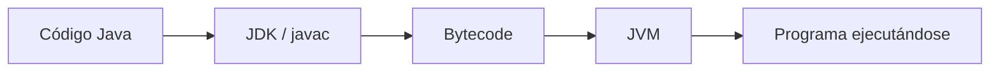
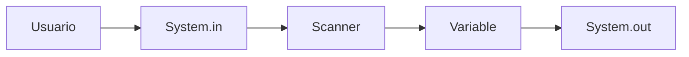
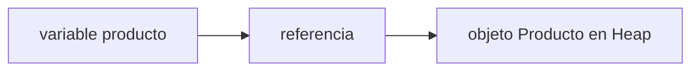

# Tema 1 — Introducción a Java
## Documento de teoría ampliada


> **Base del material:** este documento amplía la presentación V14 correspondiente.  
> **Enfoque:** mantiene el orden, terminología y ejemplos de la PPT, pero desarrolla con mayor detalle los conceptos para estudio y dictado de clase.  
> **Entorno sugerido:** JDK moderno + IntelliJ IDEA.


## Objetivos de aprendizaje

Al finalizar este tema, el estudiante debe poder:

- explicar la relación entre **JDK, JRE y JVM**;
- describir el flujo `Main.java → javac → Main.class → JVM → salida`;
- leer y explicar la estructura mínima de una aplicación Java;
- comprender la firma `public static void main(String[] args)`;
- organizar una clase usando `package` e `import`;
- realizar entrada y salida básica con `Scanner` y `System.out`;
- diferenciar errores de compilación, ejecución y lógica;
- reconocer de forma conceptual el papel de **Class Loader, JIT, Garbage Collector, Stack y Heap**.

---

# 1. JDK, JRE y JVM

## 1.1 JDK — Java Development Kit

El **JDK** es el conjunto de herramientas usadas para desarrollar aplicaciones Java.

Incluye, entre otras:

- `javac`, el compilador;
- `java`, el lanzador de aplicaciones;
- herramientas de diagnóstico;
- utilidades de documentación y empaquetado.

Ejemplo:

```text
javac Main.java
```

## 1.2 JRE — Java Runtime Environment

En el curso utilizaremos esta idea conceptual:

```text
JDK = herramientas para desarrollar
JRE = entorno para ejecutar
JVM = máquina que ejecuta bytecode
```

## 1.3 JVM — Java Virtual Machine

La JVM ejecuta el bytecode generado por el compilador.



---

# 2. Cómo funciona Java

Flujo:

```text
Main.java
   ↓
javac
   ↓
Main.class
   ↓
JVM
   ↓
resultado
```

## Código fuente

```java
public class Main {
    public static void main(String[] args) {
        System.out.println("Hola Java");
    }
}
```

## Compilar

```text
javac Main.java
```

## Ejecutar

```text
java Main
```

---

# 3. Estructura mínima de un programa Java

```java
public class Main {

    public static void main(String[] args) {

        System.out.println("Hola Java");

    }

}
```

## Clase

```java
public class Main {
}
```

## Método

```java
public static void main(String[] args) {
}
```

## Sentencia

```java
System.out.println("Hola Java");
```

## Bloques

Las llaves `{ }` delimitan bloques.

Java distingue mayúsculas de minúsculas:

```text
Main
main
MAIN
```

---

# 4. Palabras reservadas iniciales

| Palabra | Significado inicial |
|---|---|
| `public` | controla visibilidad |
| `class` | declara una clase |
| `static` | miembro asociado a la clase |
| `void` | el método no devuelve un valor |
| `return` | devuelve un valor o finaliza el método |

Ejemplo:

```java
public class Calculadora {

    public static int sumar(int a, int b) {
        return a + b;
    }

}
```

---

# 5. Método main

Firma:

```java
public static void main(String[] args)
```

## public

Permite que el método sea accesible para iniciar la aplicación.

## static

Puede ejecutarse sin crear primero:

```java
new Main();
```

## void

No devuelve un resultado Java convencional.

## String[] args

Recibe argumentos.

```text
java Main Ana 20 Lima
```

Entonces:

```java
args[0] // Ana
args[1] // 20
args[2] // Lima
```

---

# 6. Comentarios, package e import

## Comentario de línea

```java
// comentario
```

## Bloque

```java
/*
 comentario
 de varias líneas
*/
```

## Javadoc

```java
/**
 * Calcula el total.
 */
```

## package

```java
package com.idat.app;
```

Organiza clases.

## import

```java
import java.util.Scanner;
```

Permite usar:

```java
Scanner scanner;
```

---

# 7. Entrada y salida

## print

```java
System.out.print("Nombre: ");
```

## println

```java
System.out.println("Hola");
```

## Scanner

```java
import java.util.Scanner;

public class Main {

    public static void main(String[] args) {

        Scanner scanner = new Scanner(System.in);

        System.out.print("Nombre: ");
        String nombre = scanner.nextLine();

        System.out.println("Hola " + nombre);

        scanner.close();
    }
}
```



Leer números:

```java
int edad = Integer.parseInt(scanner.nextLine());
double precio = Double.parseDouble(scanner.nextLine());
```

---

# 8. IntelliJ IDEA vs terminal

## IntelliJ

- proyecto visual;
- Run;
- depuración;
- autocompletado;
- navegación.

## Terminal

```text
javac Main.java
java Main
```

Usar ambos ayuda a comprender el ciclo completo.

---

# 9. Tipos de error

## Compilación

```java
int edad = "20";
```

## Ejecución

```java
int edad = Integer.parseInt("abc");
```

## Lógico

```java
double promedio = 10 + 20 / 2;
```

Frente a:

```java
double promedio = (10 + 20) / 2.0;
```

| Tipo | Compila | Ejecuta | Resultado |
|---|---|---|---|
| compilación | no | no | no inicia |
| ejecución | sí | falla | excepción |
| lógico | sí | sí | incorrecto |

---

# 10. Class Loader, JIT y Garbage Collector

## Class Loader

Carga clases requeridas.

## JIT

Puede optimizar código que se ejecuta repetidamente.

## Garbage Collector

Administra memoria de objetos que ya no son alcanzables.

---

# 11. Stack y Heap

Modelo simplificado:

- **Stack:** llamadas y variables locales.
- **Heap:** objetos creados con `new`.

```java
Producto producto = new Producto();
```



---

# 12. Ejemplo integrador

```java
package com.idat.app;

import java.util.Scanner;

public class Main {

    public static void main(String[] args) {

        Scanner scanner = new Scanner(System.in);

        System.out.print("Nombre: ");
        String nombre = scanner.nextLine();

        System.out.print("Edad: ");
        int edad = Integer.parseInt(scanner.nextLine());

        System.out.println(
            "Usuario: " + nombre + " - Edad: " + edad
        );

        scanner.close();
    }
}
```

---

# 13. Glosario

| Concepto | Definición breve |
|---|---|
| JDK | herramientas para desarrollar Java |
| JVM | ejecuta bytecode |
| bytecode | código intermedio |
| clase | definición de un tipo |
| método | comportamiento |
| argumento | dato recibido |
| package | agrupación lógica |
| import | referencia simplificada a tipos externos |
| excepción | problema ocurrido durante ejecución |

---

# 14. Recursos de la PPT

- `https://docs.oracle.com/en/java/`
- `https://docs.oracle.com/en/java/javase/26/language/`
- `https://www.jetbrains.com/help/idea/creating-and-running-your-first-java-application.html`
