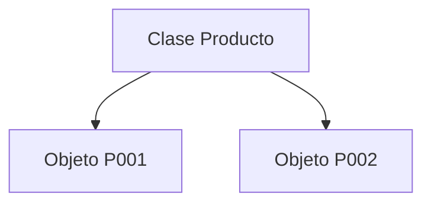
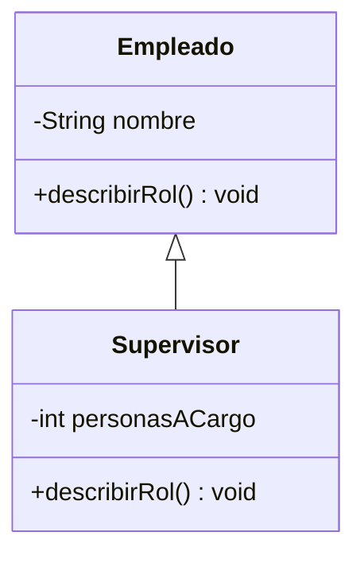

# Tema 3 — Programación Orientada a Objetos
## Documento de teoría ampliada


> **Base del material:** este documento amplía la presentación V14 correspondiente.  
> **Enfoque:** mantiene el orden, terminología y ejemplos de la PPT, pero desarrolla con mayor detalle los conceptos para estudio y dictado de clase.  
> **Entorno sugerido:** JDK moderno + IntelliJ IDEA.


# 1. POO

POO organiza software alrededor de objetos con:

- estado;
- comportamiento;
- reglas.

---

# 2. Clase vs objeto

Clase:

```java
class Producto {
    String codigo;
    String nombre;
}
```

Objeto:

```java
Producto p = new Producto();
```



---

# 3. Atributos

```java
private String codigo;
private String nombre;
private double precio;
```

Representan estado.

---

# 4. Métodos

```java
public double calcularTotal(int cantidad) {
    return precio * cantidad;
}
```

Representan comportamiento.

---

# 5. Constructor

```java
public Producto(
    String codigo,
    String nombre,
    double precio
) {
    this.codigo = codigo;
    this.nombre = nombre;
    this.precio = precio;
}
```

---

# 6. new

```java
Producto p =
    new Producto(
        "P001",
        "Mouse",
        50
    );
```

Crea una instancia.

---

# 7. this

```java
this.nombre = nombre;
```

`this.nombre` es atributo; `nombre` es parámetro.

---

# 8. Encapsulación

```java
private double saldo;

public void depositar(double monto) {

    if (monto <= 0) {
        throw new IllegalArgumentException();
    }

    saldo += monto;
}
```

La clase protege reglas.

---

# 9. Modificadores de acceso

| Contexto | public | protected | package-private | private |
|---|---|---|---|---|
| misma clase | sí | sí | sí | sí |
| mismo paquete | sí | sí | sí | no |
| subclase otro paquete | sí | sí* | no | no |
| no relacionada | sí | no | no | no |

---

# 10. Getter y setter

```java
public double getPrecio() {
    return precio;
}
```

```java
public void setPrecio(double precio) {
    if (precio <= 0) {
        throw new IllegalArgumentException();
    }
    this.precio = precio;
}
```

---

# 11. Método de dominio

Es preferible:

```java
retirar(monto)
```

a:

```java
setSaldo(...)
```

cuando existe una regla específica.

---

# 12. Herencia

```java
class Supervisor
    extends Empleado {
}
```

Debe representar:

```text
Supervisor ES UN Empleado
```

---

# 13. super

```java
public Supervisor(String nombre) {
    super(nombre);
}
```

---

# 14. @Override

```java
@Override
public void describirRol() {
    System.out.println("Supervisor");
}
```

---

# 15. Sobrecarga

```java
void registrar(String nombre) {
}

void registrar(String nombre, int edad) {
}
```

---

# 16. Override vs overload

| Aspecto | Override | Overload |
|---|---|---|
| herencia | sí | no |
| nombre | mismo | mismo |
| parámetros | compatibles | distintos |
| propósito | redefinir | ofrecer variantes |

---

# 17. Polimorfismo

```java
Empleado e =
    new Supervisor("Ana");

e.describirRol();
```

La implementación depende del objeto real.

---

# 18. UML



---

# 19. Asociación

```text
Empleado → Area
```

---

# 20. Agregación

Relación todo-parte débil.

```text
Equipo agrega Jugadores
```

---

# 21. Composición

Relación todo-parte fuerte.

```text
Pedido compone DetallesPedido
```

---

# 22. Clase abstracta

```java
abstract class Empleado {
    public abstract double calcularBono();
}
```

No se instancia directamente.

---

# 23. Interface

```java
interface Notificable {
    void notificar();
}
```

---

# 24. abstract class vs interface

| Aspecto | abstract class | interface |
|---|---|---|
| estado | sí | contrato |
| constructor | sí | no de instancia |
| herencia | una clase | múltiples interfaces |
| objetivo | base | contrato |

---

# 25. static

```java
class Contador {
    static int total;
    int valor;
}
```

---

# 26. final

Variable:

```java
final int MAX = 10;
```

Método final: no override.

Clase final: no extends.

---

# 27. SRP

Una clase debe concentrar una responsabilidad coherente.

---

# 28. Liskov

Una subclase debería poder sustituir a su superclase sin romper las expectativas del programa.

---

# 29. Integración

```java
Empleado empleado =
    new Supervisor(
        "Ana"
    );

empleado.describirRol();
```

Resume:

- herencia;
- constructor;
- `super`;
- override;
- polimorfismo.

---

# 30. Recursos

- `https://docs.oracle.com/javase/tutorial/java/javaOO/`
- `https://docs.oracle.com/javase/specs/`
- `https://www.jetbrains.com/help/idea/`
