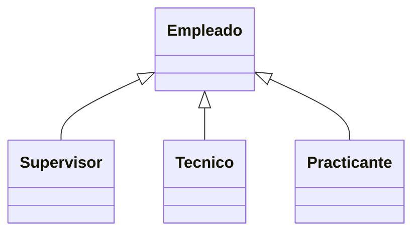

# Tema 3 — Programación Orientada a Objetos
## Laboratorio de prácticas por concepto


> **Base del material:** este documento amplía la presentación V14 correspondiente.  
> **Enfoque:** mantiene el orden, terminología y ejemplos de la PPT, pero desarrolla con mayor detalle los conceptos para estudio y dictado de clase.  
> **Entorno sugerido:** JDK moderno + IntelliJ IDEA.


# Práctica 1 — Clase y objeto

Crear `Producto` y dos objetos diferentes.

---

# Práctica 2 — Atributos

Agregar código, nombre, precio y stock.

---

# Práctica 3 — Métodos

Crear `calcularTotal(int cantidad)`.

---

# Práctica 4 — Constructor

Inicializar los atributos desde el constructor.

---

# Práctica 5 — new

Crear tres objetos y comparar sus referencias.

---

# Práctica 6 — this

Usar parámetro y atributo con el mismo nombre.

---

# Práctica 7 — Encapsulación

Cambiar atributos a `private` e intentar acceder directamente.

---

# Práctica 8 — Getter

Crear `getPrecio()`.

---

# Práctica 9 — Setter

Crear `setPrecio` validando valores positivos.

---

# Práctica 10 — Método de dominio

Crear `aumentarStock` y `reducirStock` con reglas.

---

# Práctica 11 — Modificadores

Probar public/protected/default/private desde distintos paquetes.

---

# Práctica 12 — Herencia

Crear:

```text
Empleado
└── Supervisor
```

---

# Práctica 13 — super

Inicializar nombre del padre desde Supervisor.

---

# Práctica 14 — Override

Sobrescribir `describirRol()`.

---

# Práctica 15 — Overload

Crear dos versiones de `registrar()`.

---

# Práctica 16 — Polimorfismo

```java
Empleado[] empleados = {
    new Supervisor("Ana"),
    new Tecnico("Luis"),
    new Practicante("Marta")
};
```

Recorrer y llamar `describirRol()`.

---

# Práctica 17 — UML

Diseñar UML antes de implementar.



---

# Práctica 18 — Asociación

Empleado tiene Area.

---

# Práctica 19 — Composición

Pedido contiene DetallePedido.

---

# Práctica 20 — Clase abstracta

Crear `Empleado` abstracto con `calcularBono()` abstracto.

---

# Práctica 21 — Interface

Crear `Notificable`, `Email` y `Sms`.

---

# Práctica 22 — static

Crear contador de objetos.

---

# Práctica 23 — final

Probar final en variable, método y clase.

---

# Práctica 24 — SRP

Separar una clase que hace:

- sueldo;
- email;
- PDF;
- base de datos.

---

# Práctica 25 — Proyecto final POO

Jerarquía:

```text
Empleado
├── Supervisor
├── Tecnico
└── Practicante
```

Requisitos:

- private;
- constructor;
- getters;
- validaciones;
- extends;
- super;
- override;
- polimorfismo;
- UML.

Entregar código, diagrama y pruebas.
