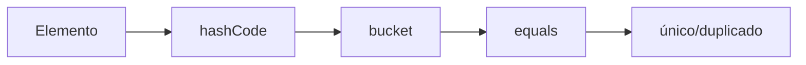

# Tema 4 — Colecciones y Arrays
## Documento de teoría ampliada


> **Base del material:** este documento amplía la presentación V14 correspondiente.  
> **Enfoque:** mantiene el orden, terminología y ejemplos de la PPT, pero desarrolla con mayor detalle los conceptos para estudio y dictado de clase.  
> **Entorno sugerido:** JDK moderno + IntelliJ IDEA.


# 1. Arrays

```java
String[] datos = {
    "A",
    "B",
    "C"
};
```

Tamaño fijo e índices desde 0.

---

# 2. Crear arrays

```java
int[] numeros = {10, 20, 30};
```

```java
String[] nombres = new String[3];
```

---

# 3. Acceso y modificación

```java
datos[0]
```

```java
datos[1] = "X";
```

---

# 4. for con array

```java
for (int i = 0; i < datos.length; i++) {
    System.out.println(datos[i]);
}
```

---

# 5. Enhanced for

```java
for (String dato : datos) {
    System.out.println(dato);
}
```

---

# 6. Matrices

```java
int[][] matriz = {
    {1, 2, 3},
    {4, 5, 6}
};
```

---

# 7. Array vs Collection

| Array | Collection |
|---|---|
| tamaño fijo | dinámico |
| índice | depende |
| primitivos directos | genéricos usan referencias |
| API limitada | API extensa |

---

# 8. ArrayList

```java
List<String> lista =
    new ArrayList<>();
```

- orden;
- duplicados;
- índice;
- tamaño dinámico.

---

# 9. add

```java
lista.add("A");
lista.add("B");
```

Insertar:

```java
lista.add(1, "X");
```

---

# 10. get

```java
lista.get(1);
```

---

# 11. set

```java
lista.set(1, "Y");
```

---

# 12. remove

```java
lista.remove(1);
```

o:

```java
lista.remove("A");
```

---

# 13. contains e indexOf

```java
lista.contains("B");
lista.indexOf("B");
```

---

# 14. HashSet

```java
Set<String> codigos =
    new HashSet<>();
```

No admite duplicados lógicos.

---

# 15. add en HashSet

```java
boolean a =
    codigos.add("P001");

boolean b =
    codigos.add("P001");
```

---

# 16. contains en HashSet

```java
codigos.contains("P001");
```

---

# 17. Modelo hash



---

# 18. HashMap

```java
Map<String, Producto> mapa =
    new HashMap<>();
```

---

# 19. put

```java
mapa.put("P001", producto);
```

La misma clave reemplaza el valor anterior.

---

# 20. get

```java
Producto p =
    mapa.get("P001");
```

---

# 21. containsKey

```java
mapa.containsKey("P001");
```

---

# 22. remove

```java
mapa.remove("P001");
```

---

# 23. keySet

```java
for (String k : mapa.keySet()) {
    System.out.println(k);
}
```

---

# 24. values

```java
for (Producto p : mapa.values()) {
    p.mostrarDetalle();
}
```

---

# 25. entrySet

```java
for (
    Map.Entry<String, Producto> e
    : mapa.entrySet()
) {
    System.out.println(
        e.getKey()
    );
}
```

---

# 26. List vs Set vs Map

| Tipo | Duplicados | Índice | Clave-valor |
|---|---|---|---|
| List | sí | sí | no |
| Set | no | no | no |
| Map | clave única | no | sí |

---

# 27. Objetos en Collections

```java
List<Producto> productos =
    new ArrayList<>();
```

---

# 28. Map de objetos

```java
Map<String, Producto> inventario =
    new HashMap<>();
```

---

# 29. equals

Define igualdad lógica.

---

# 30. hashCode

Debe ser consistente con equals.

---

# 31. Big-O introductorio

| Estructura | Operación | Valor conceptual |
|---|---|---|
| array | índice | O(1) |
| ArrayList | get | O(1) |
| ArrayList | búsqueda | O(n) |
| HashSet | búsqueda | O(1) promedio |
| HashMap | get | O(1) promedio |

---

# 32. Buckets

Modelo:

```text
clave → hash → bucket → comparación → valor
```

---

# 33. Capacidad de ArrayList

`size` es cantidad de elementos.

La capacidad interna puede ser mayor y crecer cuando sea necesario.

---

# 34. Inventario integrado

```java
List<Producto> lista =
    new ArrayList<>();

Set<String> codigos =
    new HashSet<>();

Map<String, Producto> indice =
    new HashMap<>();
```

- List: listar.
- Set: unicidad.
- Map: búsqueda.

---

# 35. Recursos

- `https://docs.oracle.com/en/java/javase/26/docs/api/java.base/java/util/package-summary.html`
- `https://docs.oracle.com/en/java/javase/26/docs/api/java.base/java/util/ArrayList.html`
- `https://docs.oracle.com/en/java/javase/26/docs/api/java.base/java/util/HashMap.html`
