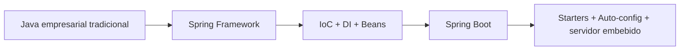
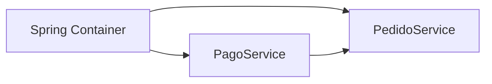
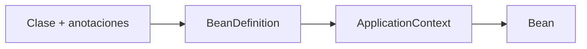
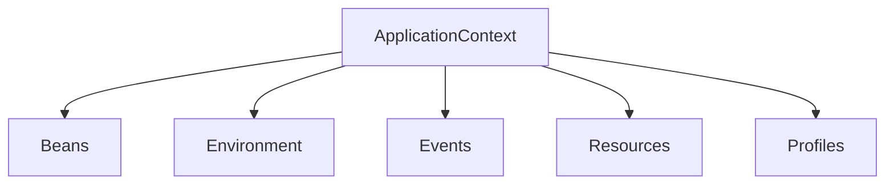
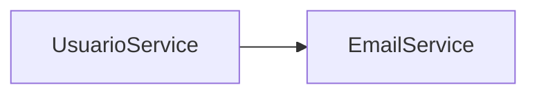
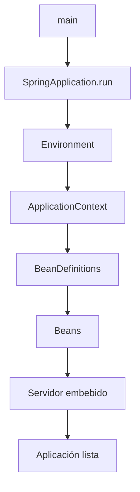
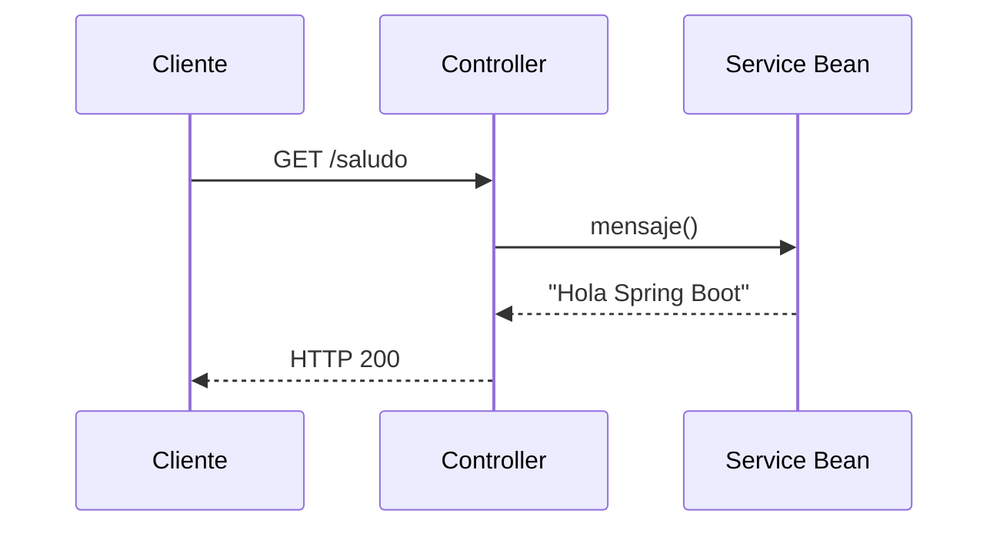

# Tema 5 — Introducción a Spring y Spring Boot
## Documento de teoría ampliada

> **Base del material:** amplía la PPT `0500_Introduccion_Spring_y_Spring_Boot_FORMATO_JAVA.pptx`.
> **Enfoque:** mantiene el orden conceptual de la presentación y profundiza IoC, Beans, ApplicationContext, DI, component scanning, lifecycle, scopes, starters y auto-configuration.
> **Entorno sugerido:** JDK 21 + IntelliJ IDEA + Maven + versión estable de Spring Boot disponible en Spring Initializr.

---

# Objetivos de aprendizaje

Al finalizar, el estudiante debe poder:

- diferenciar Spring Framework y Spring Boot;
- explicar **IoC — Inversion of Control**;
- explicar **Dependency Injection**;
- distinguir un objeto Java común de un **Spring Bean**;
- reconocer **BeanFactory** y **ApplicationContext**;
- comprender **Component Scan**;
- usar `@Component`, `@Service`, `@Repository`, `@Controller` y `@RestController`;
- aplicar inyección por constructor;
- explicar scopes y ciclo de vida;
- comprender a alto nivel `SpringApplication.run(...)`;
- explicar starters y auto-configuración.

---

# 1. Evolución conceptual

Spring Framework reorganiza la forma en la que una aplicación Java crea y conecta objetos. Spring Boot se construye sobre Spring Framework y reduce configuración repetitiva mediante convenciones, starters, auto-configuración y servidor embebido.



## Idea clave

Spring Boot **no reemplaza Spring Framework**. Utiliza su contenedor IoC y agrega una capa de simplificación para construir aplicaciones ejecutables rápidamente.

---

# 2. Spring Framework vs Spring Boot

| Aspecto | Spring Framework | Spring Boot |
|---|---|---|
| IoC / DI | sí | sí |
| Beans | sí | sí |
| ApplicationContext | sí | sí |
| configuración | más explícita | más automática |
| starters | no es el foco | sí |
| servidor embebido | no es el foco | sí |
| arranque | más configuración | simplificado |

---

# 3. IoC — Inversion of Control

Sin IoC:

```java
public class PedidoService {
    private final PagoService pagoService = new PagoService();
}
```

`PedidoService` decide qué crear, cuándo y cómo. Eso genera acoplamiento.

Con Spring:

```java
@Service
public class PedidoService {

    private final PagoService pagoService;

    public PedidoService(PagoService pagoService) {
        this.pagoService = pagoService;
    }
}
```

Ahora la clase **recibe** su dependencia. El contenedor controla creación y ensamblaje.



---

# 4. Dependency Injection

DI es la técnica con la que el contenedor entrega dependencias.

## Constructor Injection

```java
@Service
public class ProductoService {

    private final ValidadorProducto validador;

    public ProductoService(ValidadorProducto validador) {
        this.validador = validador;
    }
}
```

Ventajas:

- dependencia visible;
- permite `final`;
- facilita pruebas;
- evita objetos parcialmente inicializados;
- expresa claramente lo que necesita la clase.

## Field Injection

```java
@Autowired
private ValidadorProducto validador;
```

Funciona, pero oculta dependencias y dificulta pruebas aisladas. Para dependencias obligatorias se prefiere constructor injection.

## Setter Injection

```java
@Autowired
public void setValidador(ValidadorProducto validador) {
    this.validador = validador;
}
```

Puede ser útil para dependencias opcionales.

---

# 5. Spring Bean

Un Bean es un objeto administrado por Spring.

Un objeto normal:

```java
ProductoService service = new ProductoService(...);
```

Un Bean:

```java
@Service
public class ProductoService {
}
```

puede ser detectado y administrado por el contenedor.

---

# 6. BeanDefinition

Antes de crear un Bean, Spring maneja una definición interna con metadatos del componente.

Conceptualmente contiene:

- clase;
- nombre;
- scope;
- dependencias;
- configuración;
- inicialización;
- destrucción.



---

# 7. BeanFactory

`BeanFactory` representa el contrato básico del contenedor.

Responsabilidades conceptuales:

- registrar definiciones;
- crear Beans;
- resolver dependencias;
- recuperar Beans.

Ejemplo conceptual:

```java
Object bean = beanFactory.getBean("productoService");
```

En Spring Boot normalmente se trabaja indirectamente con esta infraestructura a través de `ApplicationContext`.

---

# 8. ApplicationContext

`ApplicationContext` amplía el contenedor básico y agrega soporte para:

- eventos;
- recursos;
- perfiles;
- environment;
- internacionalización;
- integración web.



---

# 9. Component Scan

Spring necesita descubrir componentes.

Estructura recomendada:

```text
pe.edu.idat.productos
├── ProductoApplication
├── controller
├── service
└── repository
```

Si la clase principal está en el paquete raíz, Spring normalmente escanea sus subpaquetes.

---

# 10. Estereotipos Spring

## `@Component`

Componente genérico.

```java
@Component
public class GeneradorCodigo {
}
```

## `@Service`

Componente de negocio.

```java
@Service
public class ProductoService {
}
```

## `@Repository`

Componente de acceso a datos.

```java
@Repository
public class ProductoRepository {
}
```

## `@Controller`

Controlador MVC.

## `@RestController`

Controlador orientado a API HTTP/JSON.

---

# 11. `@Configuration` y `@Bean`

No todos los Beans tienen que registrarse con estereotipos.

```java
@Configuration
public class AppConfig {

    @Bean
    public Clock reloj() {
        return Clock.systemDefaultZone();
    }
}
```

Útil para:

- clases externas;
- objetos con construcción especial;
- configuración explícita.

---

# 12. Resolución de dependencias

```java
@Service
public class EmailService {
}
```

```java
@Service
public class UsuarioService {

    private final EmailService emailService;

    public UsuarioService(EmailService emailService) {
        this.emailService = emailService;
    }
}
```

Spring construye un grafo de dependencias.



---

# 13. `@Primary`

Cuando existen múltiples Beans del mismo tipo:

```java
public interface Notificador {
    void enviar(String mensaje);
}
```

puede definirse uno como preferido:

```java
@Primary
@Service
public class EmailNotificador implements Notificador {
}
```

---

# 14. `@Qualifier`

Selecciona una implementación concreta.

```java
public UsuarioService(
    @Qualifier("smsNotificador")
    Notificador notificador
) {
    this.notificador = notificador;
}
```

---

# 15. Scope singleton

Por defecto, muchos Beans se gestionan con scope singleton.

Conceptualmente:

```text
ApplicationContext
      ↓
ProductoService
      ↓
misma instancia administrada
```

---

# 16. Scope prototype

```java
@Scope("prototype")
@Component
public class OperacionTemporal {
}
```

Cada solicitud al contenedor puede generar una nueva instancia.

---

# 17. Bean Lifecycle

```mermaid
flowchart LR
    A[BeanDefinition] --> B[Instanciación]
    B --> C[Dependency Injection]
    C --> D[Post processing]
    D --> E[@PostConstruct]
    E --> F[Bean listo]
    F --> G[@PreDestroy]
```

---

# 18. `@PostConstruct`

```java
@PostConstruct
public void inicializar() {
    System.out.println("Bean listo");
}
```

Se ejecuta después de que las dependencias principales han sido inyectadas.

---

# 19. `@PreDestroy`

```java
@PreDestroy
public void cerrar() {
    System.out.println("Cerrando recursos");
}
```

Se ejecuta antes de destruir el Bean cuando el contexto se cierra adecuadamente.

---

# 20. BeanPostProcessor

Concepto avanzado: Spring permite que componentes de infraestructura intervengan antes y después de la inicialización de Beans.

```text
crear Bean
   ↓
inyectar
   ↓
postProcessBeforeInitialization
   ↓
@PostConstruct
   ↓
postProcessAfterInitialization
```

Es una pieza importante de la extensibilidad interna del framework.

---

# 21. Proxies

Algunas capacidades de Spring se implementan mediante proxies.

```text
Controller
   ↓
Proxy
   ↓
Service real
```

El proxy puede añadir comportamiento transversal como seguridad, transacciones o aspectos.

---

# 22. `@SpringBootApplication`

```java
@SpringBootApplication
public class ProductoApplication {

    public static void main(String[] args) {
        SpringApplication.run(
            ProductoApplication.class,
            args
        );
    }
}
```

Conceptualmente activa capacidades relacionadas con:

- configuración;
- auto-configuración;
- component scanning.

---

# 23. `SpringApplication.run(...)`

Flujo conceptual:



---

# 24. Starters

Ejemplo:

```xml
<dependency>
    <groupId>org.springframework.boot</groupId>
    <artifactId>spring-boot-starter-web</artifactId>
</dependency>
```

Un starter agrupa dependencias relacionadas para reducir selección manual.

---

# 25. Auto-configuration

Spring Boot analiza:

- classpath;
- Beans existentes;
- propiedades;
- entorno.

Y aplica configuración condicional.

```text
Classpath
+
properties
+
Beans existentes
        ↓
Conditions
        ↓
Auto-configuration
```

---

# 26. Servidor embebido

Una aplicación web Spring Boot puede ejecutarse directamente:

```text
java -jar aplicacion.jar
```

Eso simplifica despliegue y pruebas locales.

---

# 27. Flujo de una petición



---

# 28. Errores conceptuales frecuentes

## Crear Services con `new`

Evita que Spring controle la dependencia.

## Paquetes fuera del component scan

Puede provocar Beans no encontrados.

## Dos Beans del mismo tipo sin resolver ambigüedad

Puede requerir:

- `@Primary`;
- `@Qualifier`.

## Field injection en todas partes

Funciona, pero oculta dependencias y dificulta pruebas.

---

# 29. Glosario

| Concepto | Definición |
|---|---|
| IoC | el framework controla creación y ensamblaje |
| DI | técnica para entregar dependencias |
| Bean | objeto administrado por Spring |
| BeanDefinition | metadatos del Bean |
| BeanFactory | contrato básico del contenedor |
| ApplicationContext | contenedor avanzado |
| Component Scan | detección automática de componentes |
| Scope | estrategia de instanciación |
| Starter | conjunto coherente de dependencias |
| Auto-configuration | configuración condicional automática |
| Proxy | intermediario administrado por infraestructura |

---

# 30. Recursos

- Spring Boot: `https://spring.io/projects/spring-boot`
- Spring Guides: `https://spring.io/guides`
- Spring Framework Reference: `https://docs.spring.io/spring-framework/reference/`
- Spring Boot Reference: `https://docs.spring.io/spring-boot/docs/current/reference/html/`
