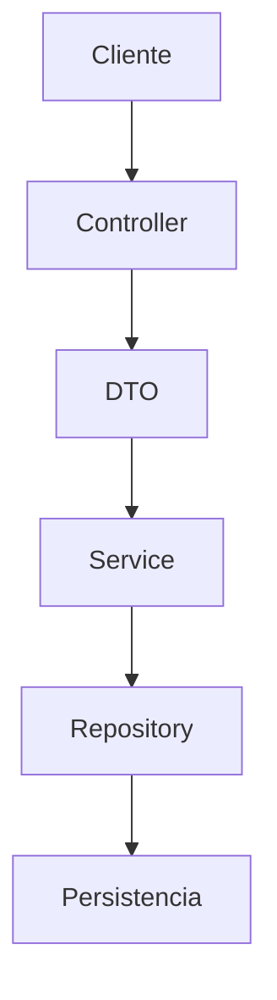
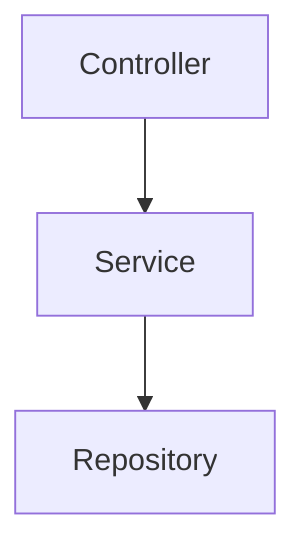
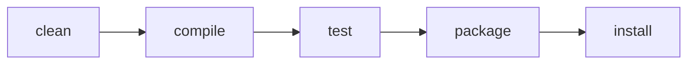
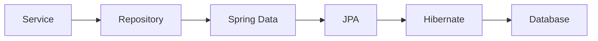
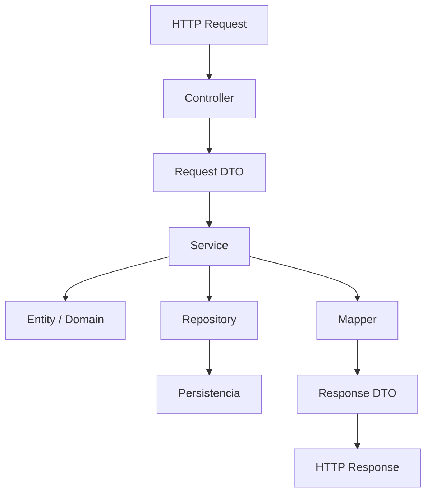

# Tema 6 — Arquitectura de aplicaciones Spring Boot
## Documento de teoría ampliada

> **Base del material:** amplía la PPT `0600_Arquitectura_Aplicaciones_Spring_Boot_FORMATO_JAVA.pptx`.
> **Enfoque:** profundiza separación de responsabilidades, dirección de dependencias, DTO, Service, Repository, Maven, configuración y organización mantenible.
> **Entorno sugerido:** JDK 21 + IntelliJ IDEA + Maven + Spring Boot.

---

# Objetivos de aprendizaje

Al finalizar, el estudiante debe poder:

- explicar una arquitectura por capas;
- distinguir Controller, DTO, Service, Repository y Entity;
- justificar la separación entre modelo interno y contrato externo;
- comprender la dirección de dependencias;
- utilizar Maven y entender `pom.xml`;
- usar configuración externa y profiles;
- comparar package-by-layer y package-by-feature;
- reconocer límites transaccionales a nivel conceptual;
- evitar Fat Controller y God Service.

---

# 1. ¿Por qué arquitectura?

En un proyecto pequeño puede parecer suficiente colocar todo en un Controller. El problema aparece cuando el Controller empieza a realizar:

- validaciones;
- reglas de negocio;
- cálculos;
- acceso a datos;
- conversiones;
- manejo de errores.

Eso genera alta responsabilidad y acoplamiento.

La arquitectura separa funciones para que cada componente tenga un motivo principal de cambio.

---

# 2. Arquitectura por capas



Lectura:

```text
HTTP
 ↓
Controller
 ↓
Service
 ↓
Repository
 ↓
Datos
```

---

# 3. Controller

Responsabilidades:

- recibir HTTP;
- leer path, query, headers y body;
- delegar al Service;
- seleccionar status;
- devolver respuesta.

No debería:

- calcular reglas complejas;
- acceder directamente a persistencia;
- construir consultas de base de datos;
- concentrar la lógica del dominio.

Ejemplo:

```java
@RestController
@RequestMapping("/productos")
public class ProductoController {

    private final ProductoService service;

    public ProductoController(ProductoService service) {
        this.service = service;
    }

    @GetMapping
    public List<ProductoResponse> listar() {
        return service.listar();
    }
}
```

---

# 4. Service

Representa casos de uso y reglas de negocio.

Ejemplos:

- registrar producto;
- validar código único;
- modificar precio;
- aumentar stock;
- desactivar producto.

```java
@Service
public class ProductoService {

    public ProductoResponse crear(ProductoRequest request) {
        validarPrecio(request.precio());
        return null;
    }
}
```

---

# 5. Repository

Repository abstrae acceso a datos.

```java
public interface ProductoRepository {

    Optional<Producto> buscarPorId(Long id);

    Producto guardar(Producto producto);
}
```

El Service depende de una abstracción y no necesita conocer SQL, JDBC o una implementación concreta.

---

# 6. Entity

Representa el modelo interno persistente.

```java
public class Producto {
    private Long id;
    private String codigo;
    private String nombre;
    private BigDecimal precio;
    private int stock;
}
```

Una Entity puede contener detalles que no deben exponerse directamente a clientes externos.

---

# 7. DTO

DTO significa Data Transfer Object.

Request:

```java
public record ProductoRequest(
    String codigo,
    String nombre,
    BigDecimal precio,
    Integer stock
) {}
```

Response:

```java
public record ProductoResponse(
    Long id,
    String codigo,
    String nombre,
    BigDecimal precio,
    Integer stock
) {}
```

---

# 8. Entity vs DTO

| Aspecto | Entity | DTO |
|---|---|---|
| persistencia | sí | no necesariamente |
| contrato HTTP | no debería ser su responsabilidad principal | sí |
| relaciones internas | puede contener | normalmente simplificadas |
| campos sensibles | puede contener | deben excluirse |
| evolución | ligada a persistencia | ligada a API |

---

# 9. Mapper

Un Mapper transforma objetos entre capas.

```java
@Component
public class ProductoMapper {

    public ProductoResponse toResponse(Producto producto) {
        return new ProductoResponse(
            producto.getId(),
            producto.getCodigo(),
            producto.getNombre(),
            producto.getPrecio(),
            producto.getStock()
        );
    }
}
```

Ventajas:

- transformación centralizada;
- Controller más limpio;
- Service más legible;
- evita repetición.

---

# 10. Dirección de dependencias



Regla simple:

- Controller puede conocer Service;
- Service puede conocer Repository;
- Repository no debe depender del Controller.

---

# 11. Fat Controller

Anti-patrón:

```java
@PostMapping
public Producto crear(@RequestBody ProductoRequest request) {
    // validar precio
    // validar stock
    // revisar duplicados
    // guardar
    // calcular respuesta
    // registrar auditoría
}
```

Problema: el Controller acumula responsabilidades.

---

# 12. God Service

Otro anti-patrón aparece cuando un único Service maneja:

- productos;
- ventas;
- clientes;
- pagos;
- reportes.

Una clase así pierde cohesión.

---

# 13. Package by layer

```text
controller
service
repository
dto
entity
```

Ventajas:

- simple de enseñar;
- responsabilidades visibles.

Desventaja:

- en proyectos grandes, cada carpeta puede contener demasiadas clases.

---

# 14. Package by feature

```text
producto
├── controller
├── service
├── repository
└── dto

cliente
├── controller
├── service
├── repository
└── dto
```

Ventaja: agrupa todo lo relacionado con una funcionalidad.

---

# 15. Maven

Maven administra:

- dependencias;
- compilación;
- pruebas;
- empaquetado;
- plugins.

Archivo principal:

```text
pom.xml
```

---

# 16. Coordenadas Maven

```xml
<groupId>pe.edu.idat</groupId>
<artifactId>producto-api</artifactId>
<version>0.0.1-SNAPSHOT</version>
```

- `groupId`: organización;
- `artifactId`: proyecto;
- `version`: versión del artefacto.

---

# 17. Dependencias

```xml
<dependency>
    <groupId>org.springframework.boot</groupId>
    <artifactId>spring-boot-starter-web</artifactId>
</dependency>
```

Una dependencia incorpora librerías requeridas por la aplicación.

---

# 18. Plugins

Ejemplo:

```xml
<plugin>
    <groupId>org.springframework.boot</groupId>
    <artifactId>spring-boot-maven-plugin</artifactId>
</plugin>
```

Participa en el proceso de construcción del proyecto.

---

# 19. Maven Lifecycle



- `clean`: elimina compilados previos;
- `compile`: compila;
- `test`: ejecuta pruebas;
- `package`: genera JAR/WAR;
- `install`: instala artefacto en repositorio local.

---

# 20. Maven Wrapper

Archivos:

```text
mvnw
mvnw.cmd
.mvn/
```

Permiten ejecutar el proyecto con la configuración Maven incorporada.

---

# 21. Estructura estándar

```text
src/main/java
src/main/resources
src/test/java
```

## `src/main/java`

Código fuente principal.

## `src/main/resources`

Configuración y recursos.

## `src/test/java`

Pruebas automatizadas.

---

# 22. Configuración externa

```properties
spring.application.name=producto-api
server.port=8080
```

Separar configuración de código permite cambiar comportamiento sin recompilar clases.

---

# 23. Profiles

Archivos típicos:

```text
application.properties
application-dev.properties
application-test.properties
application-prod.properties
```

Cada entorno puede utilizar valores diferentes.

---

# 24. Activar profile

```properties
spring.profiles.active=dev
```

También puede activarse mediante argumentos o variables de entorno.

---

# 25. Variables de entorno

```properties
server.port=${APP_PORT:8080}
```

Significa:

- usar `APP_PORT` si existe;
- usar `8080` si no existe.

---

# 26. Logging

```properties
logging.level.pe.edu.idat=DEBUG
```

Niveles:

- TRACE;
- DEBUG;
- INFO;
- WARN;
- ERROR.

---

# 27. SLF4J

```java
private static final Logger log =
    LoggerFactory.getLogger(ProductoService.class);
```

Uso:

```java
log.info("Creando producto {}", request.codigo());
```

En una aplicación mantenible conviene logging en lugar de depender de `System.out.println`.

---

# 28. Arquitectura y pruebas

Separar capas permite probar:

```text
Controller sin persistencia real
Service sin HTTP
Repository sin Controller
```

Esto mejora aislamiento y mantenibilidad.

---

# 29. Validación estructural vs negocio

Validación estructural:

- campo obligatorio;
- longitud;
- formato;
- número positivo.

Validación de negocio:

- código único;
- stock suficiente;
- estado permitido;
- transición válida.

No son equivalentes.

---

# 30. Excepciones de dominio/aplicación

```java
public class ProductoNoEncontradoException
        extends RuntimeException {
}
```

El Service puede lanzar la excepción; la capa web luego la traduce a HTTP.

---

# 31. JPA / Hibernate — visión arquitectónica

Sin profundizar aún en persistencia:



Conceptualmente:

- JPA define contratos de persistencia;
- Hibernate puede actuar como implementación;
- Spring Data simplifica repositorios.

---

# 32. Frontera transaccional

Caso de uso:

```text
registrar venta
 ↓
descontar stock
 ↓
guardar venta
 ↓
guardar detalle
```

Una transacción busca mantener consistencia si alguna operación falla.

En Spring suele aparecer:

```java
@Transactional
```

Aquí se entiende solo como concepto arquitectónico.

---

# 33. Diseño por casos de uso

Un Service expresivo puede tener:

```java
crearProducto(...)
actualizarPrecio(...)
incrementarStock(...)
desactivarProducto(...)
```

Esto comunica intención mejor que un conjunto genérico de operaciones cuando el dominio tiene reglas propias.

---

# 34. Flujo integrado



---

# 35. Checklist arquitectónico

Antes de cerrar un módulo:

- Controller delgado;
- Service con reglas;
- Repository enfocado en datos;
- DTO separado;
- Mapper definido;
- paquetes consistentes;
- configuración externa;
- logging;
- dependencias en una dirección clara.

---

# 36. Glosario

| Concepto | Significado |
|---|---|
| Controller | frontera HTTP |
| Service | casos de uso y reglas |
| Repository | acceso a datos |
| Entity | modelo persistente |
| DTO | contrato de transferencia |
| Mapper | transformación |
| Profile | configuración por entorno |
| Maven | construcción y dependencias |
| Transaction | unidad lógica de cambios |
| Logging | registro estructurado |

---

# 37. Recursos

- Spring Boot Reference: `https://docs.spring.io/spring-boot/docs/current/reference/html/`
- Maven Guides: `https://maven.apache.org/guides/`
- Spring Initializr: `https://start.spring.io/`
