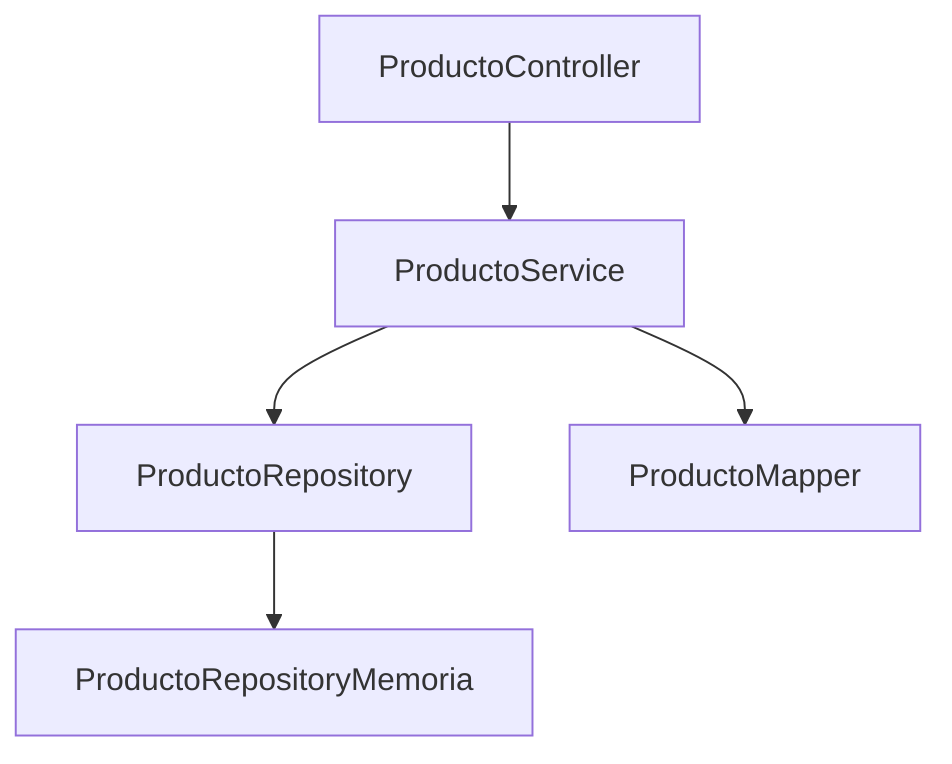

# Tema 6 — Arquitectura de aplicaciones Spring Boot
## Laboratorio práctico paso a paso

> **Objetivo:** construir un módulo `Producto` organizado por capas usando DTO, Service, Repository, Mapper, configuración, profiles y Maven.
> **Enfoque:** se utilizará inicialmente un Repository en memoria para concentrarse en arquitectura.

---

# Resultado final

```text
producto-api
└── src/main/java/pe.edu.idat.producto
    ├── ProductoApiApplication.java
    ├── controller
    │   └── ProductoController.java
    ├── dto
    │   ├── ProductoRequest.java
    │   └── ProductoResponse.java
    ├── entity
    │   └── Producto.java
    ├── mapper
    │   └── ProductoMapper.java
    ├── repository
    │   ├── ProductoRepository.java
    │   └── ProductoRepositoryMemoria.java
    ├── service
    │   └── ProductoService.java
    └── exception
        └── ProductoNoEncontradoException.java
```

---

# Práctica 1 — Crear proyecto

Spring Initializr:

```text
Project: Maven
Language: Java
Group: pe.edu.idat
Artifact: producto-api
Packaging: Jar
Java: 21
Dependency: Spring Web
```

Abrir en IntelliJ.

---

# Práctica 2 — Validar Maven

Windows:

```text
mvnw.cmd -v
```

Linux/macOS:

```text
./mvnw -v
```

Registrar Maven y Java.

---

# Práctica 3 — Crear paquetes

Dentro de `pe.edu.idat.producto` crear:

```text
controller
dto
entity
mapper
repository
service
exception
```

---

# Práctica 4 — Crear Entity `Producto`

```java
public class Producto {

    private Long id;
    private String codigo;
    private String nombre;
    private BigDecimal precio;
    private int stock;
    private boolean activo;

    public Producto(
        Long id,
        String codigo,
        String nombre,
        BigDecimal precio,
        int stock,
        boolean activo
    ) {
        this.id = id;
        this.codigo = codigo;
        this.nombre = nombre;
        this.precio = precio;
        this.stock = stock;
        this.activo = activo;
    }

    // getters y setters
}
```

---

# Práctica 5 — Justificar `BigDecimal`

Comparar:

```java
double precio;
```

con:

```java
BigDecimal precio;
```

Explicar por qué `BigDecimal` es más apropiado para valores monetarios.

---

# Práctica 6 — Crear Request DTO

```java
public record ProductoRequest(
    String codigo,
    String nombre,
    BigDecimal precio,
    Integer stock
) {}
```

---

# Práctica 7 — Crear Response DTO

```java
public record ProductoResponse(
    Long id,
    String codigo,
    String nombre,
    BigDecimal precio,
    Integer stock,
    Boolean activo
) {}
```

---

# Práctica 8 — Comparar Request y Response

| Campo | Request | Response |
|---|---|---|
| id | no | sí |
| código | sí | sí |
| nombre | sí | sí |
| precio | sí | sí |
| stock | sí | sí |
| activo | no | sí |

Explicar por qué no son idénticos.

---

# Práctica 9 — Crear Repository interface

```java
public interface ProductoRepository {

    Producto guardar(Producto producto);

    List<Producto> listar();

    Optional<Producto> buscarPorId(Long id);

    Optional<Producto> buscarPorCodigo(String codigo);

    void eliminar(Long id);
}
```

---

# Práctica 10 — Repository en memoria

```java
@Repository
public class ProductoRepositoryMemoria
        implements ProductoRepository {

    private final Map<Long, Producto> data =
        new LinkedHashMap<>();

    private long secuencia = 0;

    @Override
    public Producto guardar(Producto producto) {

        if (producto.getId() == null) {
            secuencia++;
            producto.setId(secuencia);
        }

        data.put(producto.getId(), producto);
        return producto;
    }

    @Override
    public List<Producto> listar() {
        return new ArrayList<>(data.values());
    }

    @Override
    public Optional<Producto> buscarPorId(Long id) {
        return Optional.ofNullable(data.get(id));
    }

    @Override
    public Optional<Producto> buscarPorCodigo(String codigo) {
        return data.values()
            .stream()
            .filter(p -> p.getCodigo().equalsIgnoreCase(codigo))
            .findFirst();
    }

    @Override
    public void eliminar(Long id) {
        data.remove(id);
    }
}
```

---

# Práctica 11 — Analizar Repository

Responder:

- ¿por qué Controller no conoce `Map`?;
- ¿por qué Service depende de la interfaz?;
- ¿qué cambiaría si luego se usa base de datos?

---

# Práctica 12 — Crear Mapper

```java
@Component
public class ProductoMapper {

    public Producto toEntity(ProductoRequest request) {
        return new Producto(
            null,
            request.codigo(),
            request.nombre(),
            request.precio(),
            request.stock(),
            true
        );
    }

    public ProductoResponse toResponse(Producto producto) {
        return new ProductoResponse(
            producto.getId(),
            producto.getCodigo(),
            producto.getNombre(),
            producto.getPrecio(),
            producto.getStock(),
            producto.isActivo()
        );
    }
}
```

---

# Práctica 13 — Crear excepción

```java
public class ProductoNoEncontradoException
        extends RuntimeException {

    public ProductoNoEncontradoException(Long id) {
        super("Producto no encontrado: " + id);
    }
}
```

---

# Práctica 14 — Crear Service

```java
@Service
public class ProductoService {

    private final ProductoRepository repository;
    private final ProductoMapper mapper;

    public ProductoService(
        ProductoRepository repository,
        ProductoMapper mapper
    ) {
        this.repository = repository;
        this.mapper = mapper;
    }
}
```

---

# Práctica 15 — Implementar `crear`

```java
public ProductoResponse crear(ProductoRequest request) {

    validar(request);

    if (repository.buscarPorCodigo(request.codigo()).isPresent()) {
        throw new IllegalArgumentException("Código duplicado");
    }

    Producto producto = mapper.toEntity(request);
    Producto guardado = repository.guardar(producto);

    return mapper.toResponse(guardado);
}
```

---

# Práctica 16 — Validación de negocio

```java
private void validar(ProductoRequest request) {

    if (request.precio() == null || request.precio().signum() <= 0) {
        throw new IllegalArgumentException(
            "Precio debe ser mayor que cero"
        );
    }

    if (request.stock() == null || request.stock() < 0) {
        throw new IllegalArgumentException(
            "Stock no puede ser negativo"
        );
    }
}
```

---

# Práctica 17 — Implementar `listar`

```java
public List<ProductoResponse> listar() {

    return repository.listar()
        .stream()
        .map(mapper::toResponse)
        .toList();
}
```

---

# Práctica 18 — Implementar `buscar`

```java
public ProductoResponse buscar(Long id) {

    Producto producto = repository
        .buscarPorId(id)
        .orElseThrow(
            () -> new ProductoNoEncontradoException(id)
        );

    return mapper.toResponse(producto);
}
```

---

# Práctica 19 — Crear Controller

```java
@RestController
@RequestMapping("/productos")
public class ProductoController {

    private final ProductoService service;

    public ProductoController(ProductoService service) {
        this.service = service;
    }

    @GetMapping
    public List<ProductoResponse> listar() {
        return service.listar();
    }
}
```

---

# Práctica 20 — Agregar POST

```java
@PostMapping
public ProductoResponse crear(
    @RequestBody ProductoRequest request
) {
    return service.crear(request);
}
```

En este tema se prioriza arquitectura. Los status HTTP se profundizan en el tema REST.

---

# Práctica 21 — Probar con Postman

POST:

```text
http://localhost:8080/productos
```

Body:

```json
{
  "codigo": "P001",
  "nombre": "Mouse",
  "precio": 59.90,
  "stock": 20
}
```

---

# Práctica 22 — Probar listado

GET:

```text
http://localhost:8080/productos
```

Esperado:

```json
[
  {
    "id": 1,
    "codigo": "P001",
    "nombre": "Mouse",
    "precio": 59.90,
    "stock": 20,
    "activo": true
  }
]
```

---

# Práctica 23 — Probar duplicado

Enviar nuevamente código `P001` y registrar el error.

---

# Práctica 24 — Configuración base

```properties
spring.application.name=producto-api
server.port=8080
```

---

# Práctica 25 — Crear profile dev

Archivo:

```text
application-dev.properties
```

Contenido:

```properties
logging.level.pe.edu.idat.producto=DEBUG
```

Activar:

```properties
spring.profiles.active=dev
```

---

# Práctica 26 — Variable de entorno

```properties
server.port=${APP_PORT:8080}
```

PowerShell:

```powershell
$env:APP_PORT="9090"
```

Reiniciar y comprobar nuevo puerto.

---

# Práctica 27 — Agregar logging

```java
private static final Logger log =
    LoggerFactory.getLogger(ProductoService.class);
```

Dentro de `crear`:

```java
log.info("Creando producto codigo={}", request.codigo());
```

---

# Práctica 28 — Compilar con Maven

Windows:

```text
mvnw.cmd clean compile
```

---

# Práctica 29 — Ejecutar pruebas

```text
mvnw.cmd test
```

Registrar resultado.

---

# Práctica 30 — Empaquetar

```text
mvnw.cmd clean package
```

Verificar JAR en `target`.

---

# Práctica 31 — Diagrama de dependencias



Explicar:

- quién conoce a quién;
- dónde viven las reglas;
- qué componente puede reemplazarse.

---

# Práctica 32 — Provocar Fat Controller

Mover temporalmente la validación de precio al Controller.

Comparar:

```text
Controller con regla
vs
Service con regla
```

Explicar por qué la segunda opción es mejor. Luego revertir.

---

# Práctica 33 — Analizar package-by-feature

Comparar:

```text
controller/service/repository
```

con:

```text
producto/controller
producto/service
producto/repository
```

No modificar el proyecto; justificar cuál escalaría mejor en un sistema grande.

---

# Práctica 34 — Caso integrador

Agregar:

```text
GET /productos/{id}
```

```java
@GetMapping("/{id}")
public ProductoResponse buscar(
    @PathVariable Long id
) {
    return service.buscar(id);
}
```

---

# Casos de prueba

| # | Caso | Resultado esperado |
|---|---|---|
| 1 | crear P001 | producto con id |
| 2 | listar | contiene P001 |
| 3 | duplicar P001 | error |
| 4 | precio 0 | error |
| 5 | stock -1 | error |
| 6 | buscar existente | producto |
| 7 | buscar inexistente | excepción |
| 8 | cambiar APP_PORT | nuevo puerto |
| 9 | package | JAR creado |

---

# Troubleshooting

## Repository Bean no encontrado

Verificar `@Repository`.

## Mapper no encontrado

Verificar `@Component`.

## Dos implementaciones del Repository

Resolver con `@Primary` o `@Qualifier`.

## JSON no se convierte

Verificar nombres de campos, tipos y `Content-Type`.

---

# Entregables

1. proyecto completo;
2. diagrama de arquitectura;
3. captura del árbol de paquetes;
4. `pom.xml`;
5. profile dev;
6. pruebas Postman;
7. tabla de casos;
8. explicación de Controller, DTO, Service, Repository, Entity, Mapper, Maven y profiles.
