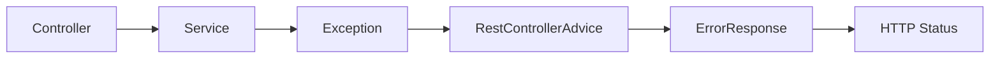
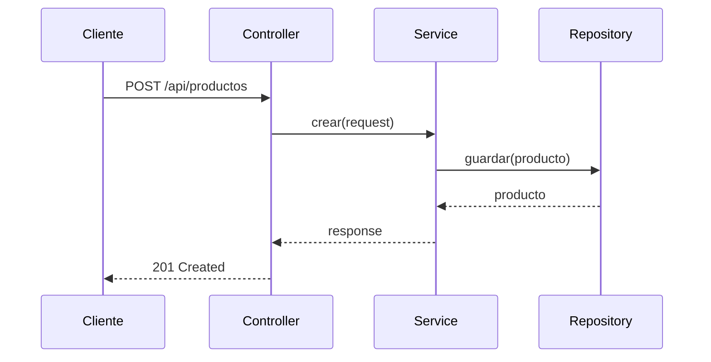

# Tema 7 — REST y APIs con Spring Boot
## Documento de teoría ampliada

> **Base del material:** amplía la PPT `0700_REST_y_APIs_con_Spring_Boot_FORMATO_JAVA.pptx`.
> **Enfoque:** profundiza semántica HTTP, diseño de recursos, métodos, idempotencia, DTO, validación, `ResponseEntity`, errores y buenas prácticas REST.
> **Entorno sugerido:** JDK 21 + IntelliJ IDEA + Spring Boot + Postman.

---

# Objetivos de aprendizaje

Al finalizar, el estudiante debe poder:

- explicar REST como estilo arquitectónico;
- diseñar URIs orientadas a recursos;
- diferenciar GET, POST, PUT, PATCH y DELETE;
- explicar `safe` e `idempotent`;
- usar `@RestController`, `@RequestMapping`, `@PathVariable`, `@RequestParam` y `@RequestBody`;
- utilizar `ResponseEntity`;
- seleccionar status HTTP adecuados;
- aplicar DTO de request y response;
- validar entrada;
- centralizar errores con `@RestControllerAdvice`;
- diseñar un formato consistente de error;
- implementar un CRUD REST completo;
- comprender filtrado y paginación a nivel conceptual.

---

# 1. REST

REST significa **Representational State Transfer**.

No es una librería ni una anotación de Spring. Es un estilo arquitectónico.

Una API REST trabaja con **recursos**.

Ejemplos:

```text
Producto
Cliente
Pedido
Factura
```

---

# 2. Recurso

Un recurso es una entidad conceptual identificable.

Colección:

```text
/api/productos
```

Elemento:

```text
/api/productos/10
```

La URI identifica el recurso; el método HTTP expresa la intención.

---

# 3. Diseño orientado a sustantivos

Preferible:

```text
GET /api/productos
POST /api/productos
GET /api/productos/10
```

Evitar:

```text
GET /api/listarProductos
POST /api/crearProducto
GET /api/buscarProducto
```

---

# 4. GET

Consulta recursos.

```text
GET /api/productos
```

Semántica:

- safe;
- idempotent.

---

# 5. POST

Crea un nuevo recurso o dispara una operación no idempotente sobre una colección.

```text
POST /api/productos
```

Dos POST idénticos podrían producir dos recursos diferentes si el backend lo permite.

---

# 6. PUT

Suele representar reemplazo completo o actualización total del recurso.

```text
PUT /api/productos/10
```

Se considera idempotente semánticamente.

---

# 7. PATCH

Actualización parcial.

```text
PATCH /api/productos/10
```

Body:

```json
{
  "stock": 50
}
```

---

# 8. DELETE

Elimina un recurso.

```text
DELETE /api/productos/10
```

Semánticamente idempotente: repetir la misma eliminación no debería crear efectos adicionales distintos de mantener el recurso ausente.

---

# 9. Safe vs idempotent

| Método | Safe | Idempotent |
|---|---|---|
| GET | sí | sí |
| POST | no | normalmente no |
| PUT | no | sí |
| PATCH | no | depende de la operación |
| DELETE | no | sí semánticamente |

---

# 10. `@RestController`

```java
@RestController
public class ProductoController {
}
```

Indica que los métodos del controlador trabajan directamente con el cuerpo de la respuesta.

---

# 11. `@RequestMapping`

```java
@RequestMapping("/api/productos")
```

Define la ruta base del recurso.

---

# 12. `@GetMapping`

```java
@GetMapping
public List<ProductoResponse> listar() {
    return service.listar();
}
```

---

# 13. `@PathVariable`

Ruta:

```text
GET /api/productos/15
```

Código:

```java
@GetMapping("/{id}")
public ProductoResponse buscar(
    @PathVariable Long id
) {
    return service.buscar(id);
}
```

---

# 14. `@RequestParam`

Ejemplo:

```text
GET /api/productos?activo=true
```

```java
@GetMapping
public List<ProductoResponse> listar(
    @RequestParam(required = false)
    Boolean activo
) {
    ...
}
```

---

# 15. `@RequestBody`

Body JSON:

```json
{
  "codigo": "P001",
  "nombre": "Mouse",
  "precio": 59.90,
  "stock": 10
}
```

Código:

```java
@PostMapping
public ProductoResponse crear(
    @RequestBody ProductoRequest request
) {
    ...
}
```

---

# 16. Content-Type y Accept

Para JSON:

```text
Content-Type: application/json
```

El cliente puede indicar el formato esperado:

```text
Accept: application/json
```

---

# 17. Serialización y deserialización

Spring convierte:

```text
JSON
 ↓
Objeto Java
```

Y en la respuesta:

```text
Objeto Java
 ↓
JSON
```

---

# 18. DTO Request

```java
public record ProductoRequest(
    String codigo,
    String nombre,
    BigDecimal precio,
    Integer stock
) {}
```

---

# 19. DTO Response

```java
public record ProductoResponse(
    Long id,
    String codigo,
    String nombre,
    BigDecimal precio,
    Integer stock,
    Boolean activo
) {}
```

Request y Response no tienen por qué ser idénticos.

---

# 20. `ResponseEntity`

Permite controlar:

- status;
- headers;
- body.

```java
return ResponseEntity.ok(response);
```

---

# 21. 200 OK

Uso común:

- GET exitoso;
- actualización exitosa con body.

---

# 22. 201 Created

Creación exitosa.

```java
return ResponseEntity
    .status(HttpStatus.CREATED)
    .body(response);
```

---

# 23. Location header

Una creación puede informar la URI del recurso nuevo.

```java
URI location = URI.create(
    "/api/productos/" + response.id()
);
```

Luego:

```java
return ResponseEntity
    .created(location)
    .body(response);
```

---

# 24. 204 No Content

Uso común:

```text
DELETE exitoso sin body
```

```java
return ResponseEntity
    .noContent()
    .build();
```

---

# 25. 400 Bad Request

Puede representar:

- JSON inválido;
- validación estructural;
- tipos incorrectos;
- request incompleto.

---

# 26. 404 Not Found

Recurso inexistente.

```text
GET /api/productos/999
```

---

# 27. 409 Conflict

Adecuado para conflictos como:

- código duplicado;
- recurso en estado incompatible;
- operación que entra en conflicto con estado actual.

---

# 28. 500 Internal Server Error

Representa error no controlado del servidor.

No debería utilizarse como respuesta por defecto para errores esperables de negocio.

---

# 29. Bean Validation

Ejemplo:

```java
public record ProductoRequest(

    @NotBlank
    String codigo,

    @NotBlank
    String nombre,

    @Positive
    BigDecimal precio,

    @PositiveOrZero
    Integer stock

) {}
```

---

# 30. `@Valid`

```java
@PostMapping
public ResponseEntity<ProductoResponse> crear(
    @Valid
    @RequestBody ProductoRequest request
) {
    ...
}
```

Activa la validación declarativa del request.

---

# 31. Validación estructural vs negocio

Validación estructural:

- obligatorio;
- longitud;
- rango;
- formato.

Regla de negocio:

- código único;
- stock suficiente;
- estado permitido;
- transición válida.

Las reglas de negocio continúan perteneciendo al Service.

---

# 32. ErrorResponse consistente

Ejemplo:

```json
{
  "timestamp": "2026-09-21T12:00:00",
  "status": 404,
  "error": "NOT_FOUND",
  "message": "Producto no encontrado",
  "path": "/api/productos/99"
}
```

Una estructura uniforme simplifica consumo del API.

---

# 33. `@RestControllerAdvice`

```java
@RestControllerAdvice
public class ApiExceptionHandler {
}
```

Centraliza manejo de excepciones de la capa web.

---

# 34. `@ExceptionHandler`

```java
@ExceptionHandler(
    ProductoNoEncontradoException.class
)
public ResponseEntity<ErrorResponse> notFound(
    ProductoNoEncontradoException ex
) {
    ...
}
```

---

# 35. Flujo de error



---

# 36. PUT vs PATCH

PUT completo:

```json
{
  "codigo": "P001",
  "nombre": "Mouse Pro",
  "precio": 79.90,
  "stock": 30
}
```

PATCH parcial:

```json
{
  "stock": 30
}
```

---

# 37. DTO específico para PATCH

```java
public record StockPatchRequest(
    @PositiveOrZero
    Integer stock
) {}
```

Un DTO específico evita reutilizar un request completo cuando solo cambia un campo.

---

# 38. Filtrado

Ejemplo:

```text
GET /api/productos?activo=true
```

También puede utilizarse:

```text
GET /api/productos?texto=mouse
```

---

# 39. Paginación

Cuando la colección crece:

```text
GET /api/productos?page=0&size=20
```

Conceptualmente:

```text
colección grande
 ↓
página
 ↓
respuesta limitada
```

---

# 40. Sorting

Ejemplo:

```text
GET /api/productos?sort=nombre,asc
```

Permite controlar orden.

---

# 41. Versionado

Una estrategia simple:

```text
/api/v1/productos
```

Puede ser útil cuando cambia un contrato de manera incompatible.

---

# 42. Idempotencia práctica

PUT repetido con el mismo body debería dejar el recurso en el mismo estado objetivo.

POST repetido puede producir múltiples efectos o múltiples recursos.

---

# 43. Richardson Maturity Model — referencia conceptual

Nivel 0:

```text
un endpoint para todo
```

Nivel 1:

```text
recursos
```

Nivel 2:

```text
recursos + métodos HTTP + status
```

Nivel 3:

```text
hipermedia
```

No es necesario implementar HATEOAS en este tema; sirve para entender niveles de madurez.

---

# 44. Flujo completo



---

# 45. Anti-patrones REST

## Verbos en URI

Evitar:

```text
/createProducto
```

## Siempre responder 200

Los status deben reflejar el resultado real.

## Exponer Entity directamente

Puede acoplar API y persistencia.

## Manejar excepciones en cada Controller

Genera repetición e inconsistencia.

---

# 46. Glosario

| Concepto | Definición |
|---|---|
| REST | estilo arquitectónico |
| resource | entidad identificable |
| URI | identificador del recurso |
| method | intención HTTP |
| safe | no debería cambiar estado |
| idempotent | repetir conserva el mismo estado objetivo |
| DTO | contrato de entrada/salida |
| ResponseEntity | status + headers + body |
| ControllerAdvice | manejo centralizado |
| Validation | validación declarativa |

---

# 47. Recursos

- Spring Web MVC: `https://docs.spring.io/spring-framework/reference/web/webmvc.html`
- Spring REST guide: `https://spring.io/guides/gs/rest-service/`
- HTTP methods: `https://developer.mozilla.org/en-US/docs/Web/HTTP/Reference/Methods`


---

# 50. Métodos HTTP adicionales: HEAD, OPTIONS, TRACE, CONNECT y QUERY

Aunque en un CRUD típico se usan principalmente `GET`, `POST`, `PUT`, `PATCH` y `DELETE`, HTTP contempla otros métodos que conviene conocer.

| Método | Uso conceptual | Comentario |
|---|---|---|
| `HEAD` | obtener solo headers | similar a `GET`, pero sin body |
| `OPTIONS` | consultar métodos disponibles | usado también en CORS/preflight |
| `TRACE` | diagnóstico/eco de solicitud | suele estar deshabilitado por seguridad |
| `CONNECT` | establecer túnel | frecuente en proxies |
| `QUERY` | consulta segura con body | útil para consultas complejas |

---

# 51. Query parameters vs método QUERY

Los **query parameters** no son un método HTTP. Son parte de la URI.

Ejemplo:

```text
GET /api/productos?texto=mouse&activo=true&page=0&size=20
```

En Spring Boot se leen con:

```java
@GetMapping
public List<ProductoResponse> listar(
    @RequestParam(required = false)
    String texto,

    @RequestParam(required = false)
    Boolean activo
) {
    return service.listar(texto, activo);
}
```

El método **QUERY**, en cambio, representa una consulta segura e idempotente donde la descripción de la búsqueda puede viajar en el contenido del request.

Ejemplo conceptual:

```http
QUERY /api/productos HTTP/1.1
Content-Type: application/json
Accept: application/json

{
  "texto": "mouse gamer",
  "categorias": ["perifericos", "ofertas"],
  "precioMin": 50,
  "precioMax": 200
}
```

---

# 52. ¿Por qué existe QUERY?

`GET` funciona bien para búsquedas simples:

```text
GET /api/productos?texto=mouse
```

Pero puede volverse incómodo cuando el filtro es grande:

```json
{
  "texto": "mouse gamer",
  "categorias": ["perifericos", "ofertas", "inalambricos"],
  "marcas": ["A", "B", "C"],
  "precioMin": 50,
  "precioMax": 500,
  "atributos": {
    "color": ["negro", "gris"],
    "conexion": ["usb", "bluetooth"]
  }
}
```

En esos casos se suelen ver dos soluciones:

## Opción práctica frecuente

```text
POST /api/productos/buscar
```

Aunque técnicamente `POST` no comunica tan bien que la operación es una consulta segura.

## Opción semántica moderna

```text
QUERY /api/productos
```

Expresa mejor que se trata de una consulta que no modifica estado.

---

# 53. Consideración práctica en Spring Boot

Aunque `QUERY` es importante conceptualmente, su soporte puede depender de:

- versión de Spring;
- servidor embebido;
- cliente HTTP;
- proxies intermedios;
- librerías utilizadas.

Por eso, para prácticas de clase con Spring Boot se recomienda:

1. usar `GET + query parameters` para filtros simples;
2. usar `POST /recurso/buscar` cuando se requiera compatibilidad amplia y filtros complejos;
3. explicar `QUERY` como método HTTP orientado a consultas seguras con body;
4. no confundir `QUERY` con los `query parameters`.

---

# 54. Tabla comparativa: GET, POST y QUERY para búsquedas

| Caso | Método recomendado | Motivo |
|---|---|---|
| filtro simple | `GET` | visible, cacheable, estándar |
| filtro mediano con paginación | `GET` | query params suficientes |
| filtro grande y complejo | `POST /buscar` | compatible en herramientas actuales |
| filtro complejo con semántica estricta de consulta | `QUERY` | safe e idempotente |
| operación que crea recurso | `POST` | cambia estado |
| actualización parcial | `PATCH` | modifica parte del recurso |

---

# 55. HEAD

`HEAD` solicita la misma información de headers que `GET`, pero sin el cuerpo.

Ejemplo:

```http
HEAD /api/productos/1 HTTP/1.1
```

Puede servir para validar:

- existencia;
- tamaño;
- fecha de modificación;
- headers;
- disponibilidad.

---

# 56. OPTIONS

`OPTIONS` consulta qué métodos pueden usarse sobre un recurso.

Ejemplo conceptual:

```http
OPTIONS /api/productos HTTP/1.1
```

Respuesta posible:

```http
Allow: GET, POST, OPTIONS
```

También aparece en escenarios CORS como preflight request.

---

# 57. TRACE y CONNECT

`TRACE` se usa para diagnóstico, pero en muchas aplicaciones está deshabilitado por seguridad.

`CONNECT` se usa para túneles, normalmente en escenarios de proxy.

No son métodos habituales para CRUD de negocio en Spring Boot.

---

# 58. Matriz extendida de métodos

| Método | Safe | Idempotente | Body request | Uso común |
|---|---|---|---|---|
| GET | sí | sí | no recomendado | lectura simple |
| HEAD | sí | sí | no | metadata |
| POST | no | no típico | sí | creación/proceso |
| PUT | no | sí | sí | reemplazo |
| PATCH | no | depende | sí | cambio parcial |
| DELETE | no | sí conceptual | opcional | eliminación |
| OPTIONS | sí | sí | no | capacidades/CORS |
| TRACE | sí conceptual | sí | no | diagnóstico |
| CONNECT | no | no | depende | túnel |
| QUERY | sí | sí | sí | búsqueda compleja |


---

# 59. Métodos HTTP completos en una API Spring Boot

En una API Spring Boot no basta con conocer únicamente `GET`, `POST`, `PUT`, `PATCH` y `DELETE`.

HTTP también define o registra otros métodos relevantes para diseño, diagnóstico, metadata o consultas avanzadas.

## 59.1 Métodos base de HTTP Semantics

| Método | Propósito |
|---|---|
| `GET` | transferir una representación actual del recurso |
| `HEAD` | igual que GET, pero sin contenido de respuesta |
| `POST` | procesar contenido enviado por el cliente |
| `PUT` | reemplazar representaciones del recurso |
| `DELETE` | eliminar representaciones del recurso |
| `CONNECT` | establecer un túnel hacia el servidor |
| `OPTIONS` | describir opciones de comunicación |
| `TRACE` | realizar prueba de loop-back de la solicitud |

HTTP Semantics también establece que `GET` y `HEAD` deben ser soportados por servidores generales; otros métodos son opcionales y un servidor puede responder `405` si reconoce el método pero no está permitido, o `501` si no lo implementa.

---

# 60. PATCH

`PATCH` no pertenece a la tabla base original de HTTP Semantics, pero es un método estandarizado y ampliamente usado para modificación parcial.

Ejemplo:

```http
PATCH /api/productos/10/stock
Content-Type: application/json

{
  "stock": 40
}
```

Diferencia principal:

```text
PUT   → reemplazo completo
PATCH → modificación parcial
```

---

# 61. QUERY

`QUERY` es un método HTTP definido para consultas seguras e idempotentes con contenido en el request.

Permite expresar una consulta compleja sin usar `POST` como reemplazo semántico.

Ejemplo conceptual:

```http
QUERY /api/productos HTTP/1.1
Content-Type: application/json
Accept: application/json

{
  "texto": "mouse gamer",
  "categorias": ["perifericos", "ofertas"],
  "precioMin": 50,
  "precioMax": 200,
  "activo": true
}
```

## Propiedades

| Propiedad | QUERY |
|---|---|
| modifica estado solicitado | no |
| safe | sí |
| idempotente | sí |
| puede llevar body | sí |
| caso típico | búsqueda compleja |

---

# 62. Query parameters no son el método QUERY

Los query parameters son parte de la URI:

```http
GET /api/productos?texto=mouse&activo=true
```

El método usado es `GET`.

En Spring Boot:

```java
@GetMapping
public ResponseEntity<List<ProductoResponse>> listar(
    @RequestParam(required = false)
    String texto,

    @RequestParam(required = false)
    Boolean activo
) {
    return ResponseEntity.ok(
        service.listar(texto, activo)
    );
}
```

`QUERY`, en cambio, es un método HTTP:

```http
QUERY /api/productos
Content-Type: application/json
```

---

# 63. GET vs POST /buscar vs QUERY

| Caso | Recomendación práctica |
|---|---|
| filtro simple | `GET /productos?texto=mouse` |
| paginación y orden simple | `GET /productos?page=0&size=20&sort=nombre,asc` |
| filtro muy complejo en sistemas actuales | `POST /productos/buscar` |
| filtro complejo con semántica HTTP estricta | `QUERY /productos` |
| creación de recurso | `POST /productos` |

`POST /buscar` es una alternativa práctica frecuente porque herramientas, proxies y frameworks lo soportan ampliamente.

`QUERY` expresa mejor que se trata de una consulta segura, pero su soporte real puede variar según servidor, framework, cliente y proxies.

---

# 64. Implementación compatible de QUERY en Spring Boot

Si Spring Boot / Spring MVC no ofrece un enum directo para `QUERY`, puede documentarse conceptualmente o tratarse como caso avanzado usando una ruta dedicada y validando el método recibido.

```java
@RequestMapping("/api/productos/_query")
public ResponseEntity<List<ProductoResponse>> query(
        HttpServletRequest request,
        @RequestBody ProductoFiltroRequest filtro
) {

    if (!"QUERY".equals(
        request.getMethod()
    )) {
        return ResponseEntity
            .status(HttpStatus.METHOD_NOT_ALLOWED)
            .build();
    }

    return ResponseEntity.ok(
        service.buscar(filtro)
    );
}
```

Esto no reemplaza la necesidad de validar compatibilidad con:

- servidor embebido;
- cliente HTTP;
- proxy;
- gateway;
- política de seguridad.

---

# 65. HEAD en Spring Boot

`HEAD` permite solicitar headers sin transferir el cuerpo.

Ejemplo:

```bash
curl -I http://localhost:8080/api/productos/1
```

Uso conceptual:

- validar existencia;
- revisar headers;
- evitar descargar body;
- obtener metadata.

En muchos frameworks, `HEAD` puede resolverse a partir de un endpoint `GET`.

---

# 66. OPTIONS en Spring Boot

`OPTIONS` permite conocer opciones de comunicación.

Ejemplo:

```bash
curl -X OPTIONS -i http://localhost:8080/api/productos
```

Puede devolver:

```http
Allow: GET,POST,PUT,PATCH,DELETE,OPTIONS
```

También aparece en CORS como preflight request.

---

# 67. TRACE

`TRACE` devuelve un loop-back de la solicitud.

Por seguridad, suele estar deshabilitado.

En una API de negocio Spring Boot normalmente no se implementa.

Prueba conceptual:

```bash
curl -X TRACE -i http://localhost:8080/api/productos
```

Resultados posibles:

- `405 Method Not Allowed`;
- `501 Not Implemented`;
- bloqueo del servidor.

---

# 68. CONNECT

`CONNECT` se usa para establecer túneles, normalmente con proxies.

No es un método típico de un CRUD REST.

Prueba conceptual:

```bash
curl -X CONNECT -i http://localhost:8080/api/productos
```

Resultados posibles:

- `405 Method Not Allowed`;
- `501 Not Implemented`;
- `400 Bad Request`;
- bloqueo por servidor/proxy.

---

# 69. 405 vs 501

| Status | Significado |
|---|---|
| `405 Method Not Allowed` | el método existe, pero no está permitido para ese recurso |
| `501 Not Implemented` | el servidor no reconoce o no implementa el método |

Ejemplo:

```text
TRACE /api/productos
```

Si el servidor reconoce el método pero no lo permite, puede responder 405.

Si no lo implementa, puede responder 501.

---

# 70. Tabla final extendida

| Método | Safe | Idempotente | Body request | Uso en clase |
|---|---|---|---|---|
| GET | sí | sí | evitar | consulta simple |
| HEAD | sí | sí | no | metadata |
| POST | no | no típico | sí | crear/procesar |
| PUT | no | sí | sí | reemplazo |
| PATCH | no | depende | sí | cambio parcial |
| DELETE | no | sí conceptual | opcional | eliminar |
| OPTIONS | sí | sí | no | métodos permitidos/CORS |
| TRACE | sí conceptual | sí | no | diagnóstico, normalmente bloqueado |
| CONNECT | no | no | depende | túnel/proxy |
| QUERY | sí | sí | sí | consulta compleja con body |


---

# Anexo completo — Métodos HTTP implementados y enseñados

Este anexo complementa la teoría REST del tema 7 para que el estudiante no solo conozca los métodos de CRUD, sino también los métodos de protocolo y consulta avanzada.

---

# A1. Métodos HTTP trabajados en el curso

| Método | Tipo | Uso principal | Se implementa en práctica |
|---|---|---|---|
| `GET` | lectura | listar, buscar, filtrar | sí |
| `HEAD` | metadata | obtener headers sin body | sí |
| `POST` | escritura/proceso | crear recurso | sí |
| `PUT` | escritura | reemplazar recurso | sí |
| `PATCH` | escritura parcial | modificar parte del recurso | sí |
| `DELETE` | eliminación | eliminar recurso | sí |
| `OPTIONS` | protocolo | descubrir métodos permitidos | sí |
| `TRACE` | diagnóstico | eco controlado de request | sí, solo laboratorio |
| `QUERY` | consulta avanzada | búsqueda safe + idempotente con body | sí, con Servlet personalizado |
| `CONNECT` | túnel | proxy/tunneling | sí, reconocido con respuesta 501 |

---

# A2. Métodos declarativos en Spring MVC

Spring MVC permite trabajar de forma declarativa con:

```java
RequestMethod.GET
RequestMethod.HEAD
RequestMethod.POST
RequestMethod.PUT
RequestMethod.PATCH
RequestMethod.DELETE
RequestMethod.OPTIONS
RequestMethod.TRACE
```

Ejemplo:

```java
@RequestMapping(
    value = "/{id}",
    method = RequestMethod.HEAD
)
public ResponseEntity<Void> head(
        @PathVariable Long id
) {
    return ResponseEntity.ok().build();
}
```

---

# A3. Métodos no declarativos en Spring MVC: QUERY y CONNECT

`QUERY` y `CONNECT` no tienen una constante equivalente en `RequestMethod`.

Por eso en la práctica se implementan con Servlets:

```text
QUERY   → QueryMethodServlet
CONNECT → ConnectMethodServlet
```

El objetivo no es inventar anotaciones que no existen, sino enseñar cómo manejar métodos HTTP avanzados cuando el framework declarativo no ofrece una abstracción directa.

---

# A4. GET

`GET` solicita una representación.

Ejemplo:

```http
GET /api/productos HTTP/1.1
```

Propiedades:

- safe;
- idempotente;
- recomendado para consultas simples;
- puede usar query parameters.

Ejemplo con query parameters:

```http
GET /api/productos?texto=mouse&activo=true HTTP/1.1
```

---

# A5. HEAD

`HEAD` es equivalente a `GET`, pero sin body.

Ejemplo:

```http
HEAD /api/productos/1 HTTP/1.1
```

Uso:

- validar existencia;
- leer headers;
- evitar transferencia del body.

---

# A6. POST

`POST` envía contenido para que el servidor lo procese.

Ejemplo:

```http
POST /api/productos HTTP/1.1
Content-Type: application/json
```

En creación exitosa normalmente responde:

```http
201 Created
Location: /api/productos/1
```

---

# A7. PUT

`PUT` representa reemplazo completo.

Ejemplo:

```http
PUT /api/productos/1 HTTP/1.1
Content-Type: application/json
```

Propiedad importante:

```text
idempotente
```

Repetir el mismo `PUT` debe dejar el recurso en el mismo estado objetivo.

---

# A8. PATCH

`PATCH` modifica parcialmente un recurso.

Ejemplo:

```http
PATCH /api/productos/1/stock HTTP/1.1
Content-Type: application/json

{
  "stock": 100
}
```

Diferencia central:

```text
PUT   → reemplazo completo
PATCH → modificación parcial
```

---

# A9. DELETE

`DELETE` elimina un recurso.

Ejemplo:

```http
DELETE /api/productos/1 HTTP/1.1
```

Respuesta común:

```http
204 No Content
```

---

# A10. OPTIONS

`OPTIONS` consulta las capacidades de comunicación de un recurso.

Ejemplo:

```http
OPTIONS /api/productos HTTP/1.1
```

Puede responder:

```http
Allow: GET, HEAD, POST, PUT, PATCH, DELETE, OPTIONS, TRACE, QUERY
```

También es importante para CORS preflight.

---

# A11. TRACE

`TRACE` es diagnóstico. El servidor puede devolver un eco de la solicitud recibida.

Ejemplo:

```http
TRACE /api/http-lab/trace HTTP/1.1
```

En producción suele deshabilitarse por seguridad.

En el laboratorio se implementa controladamente y se filtran headers sensibles:

```text
Authorization
Cookie
Proxy-Authorization
```

---

# A12. QUERY

`QUERY` es un método HTTP para consultas server-side con body.

Propiedades:

- safe;
- idempotente;
- permite contenido;
- útil para búsquedas complejas.

Ejemplo:

```http
QUERY /api/productos/_query HTTP/1.1
Content-Type: application/json

{
  "texto": "mouse",
  "precioMin": 50,
  "precioMax": 200,
  "activo": true
}
```

Diferencia con query parameters:

```text
GET /api/productos?texto=mouse
```

usa el método `GET`.

Mientras:

```text
QUERY /api/productos/_query
```

usa el método `QUERY`.

---

# A13. CONNECT

`CONNECT` se usa para establecer túneles, normalmente mediante proxies.

No es método de CRUD.

En el laboratorio se reconoce y responde:

```http
501 Not Implemented
```

Esto enseña que el servidor entiende el método, pero la aplicación no implementa tunneling.

---

# A14. 405 vs 501

| Status | Significado |
|---|---|
| `405 Method Not Allowed` | el método existe, pero no está permitido para ese recurso |
| `501 Not Implemented` | el servidor no implementa esa funcionalidad |

Ejemplo:

```text
POST /api/productos/_query
→ 405
```

```text
CONNECT /api/http-lab/connect
→ 501
```

---

# A15. Resumen conceptual

```text
GET      → consultar
HEAD     → consultar headers
POST     → crear/procesar
PUT      → reemplazar
PATCH    → modificar parte
DELETE   → eliminar
OPTIONS  → descubrir métodos
TRACE    → diagnóstico
QUERY    → consultar con body
CONNECT  → túnel de red
```
