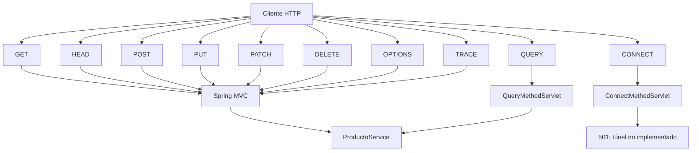

# Tema 7 — REST y APIs con Spring Boot
## 0702 — Laboratorio práctico completo de métodos HTTP

> **Objetivo general:** implementar y enseñar, uno por uno, los métodos `GET`, `HEAD`, `POST`, `PUT`, `PATCH`, `DELETE`, `OPTIONS`, `TRACE`, `CONNECT` y `QUERY` dentro de un proyecto Spring Boot.
>
> **Entorno sugerido:** JDK 21 + IntelliJ IDEA + Maven + Spring Boot 3.5+ o 4.x + Spring Web + Validation.
>
> **Nota técnica:** Spring MVC expone actualmente en `RequestMethod` los métodos `GET`, `HEAD`, `POST`, `PUT`, `PATCH`, `DELETE`, `OPTIONS` y `TRACE`. `QUERY` y `CONNECT` no tienen una constante declarativa equivalente. Por eso este laboratorio usa infraestructura Servlet personalizada para ambos.
>
> **QUERY:** desde junio de 2026, RFC 10008 define `QUERY` como un método HTTP seguro e idempotente que puede transportar contenido en el request.

---

# 0. Resultado final

```text
rest-http-lab
└── src
    └── main
        ├── java
        │   └── pe.edu.idat.restlab
        │       ├── RestHttpLabApplication.java
        │       ├── controller
        │       │   ├── ProductoController.java
        │       │   └── TraceController.java
        │       ├── dto
        │       │   ├── ProductoRequest.java
        │       │   ├── ProductoResponse.java
        │       │   ├── ProductoPatchRequest.java
        │       │   └── ProductoFiltroRequest.java
        │       ├── model
        │       │   └── Producto.java
        │       ├── repository
        │       │   └── ProductoRepositoryMemoria.java
        │       ├── service
        │       │   └── ProductoService.java
        │       ├── exception
        │       │   ├── ProductoNoEncontradoException.java
        │       │   └── CodigoDuplicadoException.java
        │       ├── advice
        │       │   └── ApiExceptionHandler.java
        │       ├── servlet
        │       │   ├── QueryMethodServlet.java
        │       │   └── ConnectMethodServlet.java
        │       └── config
        │           └── ExtendedMethodServletConfig.java
        └── resources
            └── application.properties
```

---

# 1. Matriz general

| Método | Safe | Idempotente | Body request | Finalidad en el laboratorio |
|---|---:|---:|---:|---|
| `GET` | sí | sí | no | listar, buscar y filtrar |
| `HEAD` | sí | sí | no | consultar headers sin body |
| `POST` | no | no típico | sí | crear producto |
| `PUT` | no | sí | sí | reemplazar producto |
| `PATCH` | no | depende | sí | cambiar solo stock |
| `DELETE` | no | sí semántico | opcional | eliminar |
| `OPTIONS` | sí | sí | no | descubrir métodos permitidos |
| `TRACE` | diagnóstico | sí | no | eco controlado de request |
| `CONNECT` | no | no | especial | tunneling; se reconoce y se rechaza |
| `QUERY` | sí | sí | sí | consulta compleja con body |

---

# 2. Crear el proyecto

## Paso 2.1 — Spring Initializr

```text
Project: Maven
Language: Java
Spring Boot: versión estable disponible
Group: pe.edu.idat
Artifact: rest-http-lab
Packaging: Jar
Java: 21
```

Dependencias:

```text
Spring Web
Validation
```

## Paso 2.2 — Abrir en IntelliJ

Validar:

```text
pom.xml
src/main/java
src/main/resources
src/test/java
```

---

# 3. Configuración MVC

`application.properties`:

```properties
spring.application.name=rest-http-lab
server.port=8080

spring.mvc.dispatch-options-request=true

# Solo para este laboratorio:
spring.mvc.dispatch-trace-request=true
```

`TRACE` debe volver a `false` al finalizar la práctica.

---

# 4. Modelo Producto

```java
package pe.edu.idat.restlab.model;

import java.math.BigDecimal;

public class Producto {

    private Long id;
    private String codigo;
    private String nombre;
    private BigDecimal precio;
    private int stock;
    private boolean activo;

    public Producto() {
    }

    public Producto(
            Long id,
            String codigo,
            String nombre,
            BigDecimal precio,
            int stock,
            boolean activo
    ) {
        this.id = id;
        this.codigo = codigo;
        this.nombre = nombre;
        this.precio = precio;
        this.stock = stock;
        this.activo = activo;
    }

    public Long getId() {
        return id;
    }

    public void setId(Long id) {
        this.id = id;
    }

    public String getCodigo() {
        return codigo;
    }

    public void setCodigo(String codigo) {
        this.codigo = codigo;
    }

    public String getNombre() {
        return nombre;
    }

    public void setNombre(String nombre) {
        this.nombre = nombre;
    }

    public BigDecimal getPrecio() {
        return precio;
    }

    public void setPrecio(BigDecimal precio) {
        this.precio = precio;
    }

    public int getStock() {
        return stock;
    }

    public void setStock(int stock) {
        this.stock = stock;
    }

    public boolean isActivo() {
        return activo;
    }

    public void setActivo(boolean activo) {
        this.activo = activo;
    }
}
```

---

# 5. DTO ProductoRequest

```java
package pe.edu.idat.restlab.dto;

import jakarta.validation.constraints.NotBlank;
import jakarta.validation.constraints.NotNull;
import jakarta.validation.constraints.Positive;
import jakarta.validation.constraints.PositiveOrZero;

import java.math.BigDecimal;

public record ProductoRequest(

        @NotBlank(message = "Código obligatorio")
        String codigo,

        @NotBlank(message = "Nombre obligatorio")
        String nombre,

        @NotNull(message = "Precio obligatorio")
        @Positive(message = "Precio debe ser positivo")
        BigDecimal precio,

        @NotNull(message = "Stock obligatorio")
        @PositiveOrZero(message = "Stock no puede ser negativo")
        Integer stock
) {
}
```

---

# 6. DTO ProductoResponse

```java
package pe.edu.idat.restlab.dto;

import java.math.BigDecimal;

public record ProductoResponse(
        Long id,
        String codigo,
        String nombre,
        BigDecimal precio,
        Integer stock,
        Boolean activo
) {
}
```

---

# 7. DTO para PATCH

```java
package pe.edu.idat.restlab.dto;

import jakarta.validation.constraints.NotNull;
import jakarta.validation.constraints.PositiveOrZero;

public record ProductoPatchRequest(

        @NotNull(message = "Stock obligatorio")
        @PositiveOrZero(message = "Stock no puede ser negativo")
        Integer stock
) {
}
```

---

# 8. DTO para QUERY

```java
package pe.edu.idat.restlab.dto;

import java.math.BigDecimal;
import java.util.List;

public record ProductoFiltroRequest(
        String texto,
        BigDecimal precioMin,
        BigDecimal precioMax,
        Boolean activo,
        List<String> categorias
) {
}
```

---

# 9. Repository en memoria

```java
package pe.edu.idat.restlab.repository;

import org.springframework.stereotype.Repository;
import pe.edu.idat.restlab.model.Producto;

import java.util.ArrayList;
import java.util.LinkedHashMap;
import java.util.List;
import java.util.Map;
import java.util.Optional;

@Repository
public class ProductoRepositoryMemoria {

    private final Map<Long, Producto> data =
            new LinkedHashMap<>();

    private long secuencia = 0;

    public synchronized Producto guardar(
            Producto producto
    ) {

        if (producto.getId() == null) {
            secuencia++;
            producto.setId(secuencia);
        }

        data.put(producto.getId(), producto);

        return producto;
    }

    public List<Producto> listar() {
        return new ArrayList<>(data.values());
    }

    public Optional<Producto> buscarPorId(Long id) {
        return Optional.ofNullable(data.get(id));
    }

    public Optional<Producto> buscarPorCodigo(
            String codigo
    ) {
        return data.values()
                .stream()
                .filter(p ->
                        p.getCodigo()
                                .equalsIgnoreCase(codigo)
                )
                .findFirst();
    }

    public void eliminar(Long id) {
        data.remove(id);
    }
}
```

---

# 10. Excepciones

```java
package pe.edu.idat.restlab.exception;

public class ProductoNoEncontradoException
        extends RuntimeException {

    public ProductoNoEncontradoException(Long id) {
        super("Producto no encontrado: " + id);
    }
}
```

```java
package pe.edu.idat.restlab.exception;

public class CodigoDuplicadoException
        extends RuntimeException {

    public CodigoDuplicadoException(String codigo) {
        super("Código ya existe: " + codigo);
    }
}
```

---

# 11. Service

```java
package pe.edu.idat.restlab.service;

import org.springframework.stereotype.Service;
import pe.edu.idat.restlab.dto.ProductoFiltroRequest;
import pe.edu.idat.restlab.dto.ProductoRequest;
import pe.edu.idat.restlab.dto.ProductoResponse;
import pe.edu.idat.restlab.exception.CodigoDuplicadoException;
import pe.edu.idat.restlab.exception.ProductoNoEncontradoException;
import pe.edu.idat.restlab.model.Producto;
import pe.edu.idat.restlab.repository.ProductoRepositoryMemoria;

import java.util.List;

@Service
public class ProductoService {

    private final ProductoRepositoryMemoria repository;

    public ProductoService(
            ProductoRepositoryMemoria repository
    ) {
        this.repository = repository;
    }

    public List<ProductoResponse> listar(
            String texto,
            Boolean activo
    ) {
        return repository.listar()
                .stream()
                .filter(p ->
                        texto == null ||
                        p.getCodigo()
                                .toLowerCase()
                                .contains(texto.toLowerCase()) ||
                        p.getNombre()
                                .toLowerCase()
                                .contains(texto.toLowerCase())
                )
                .filter(p ->
                        activo == null ||
                        p.isActivo() == activo
                )
                .map(this::toResponse)
                .toList();
    }

    public ProductoResponse buscar(Long id) {
        return toResponse(
                getProducto(id)
        );
    }

    public ProductoResponse crear(
            ProductoRequest request
    ) {
        repository.buscarPorCodigo(request.codigo())
                .ifPresent(
                        p -> {
                            throw new CodigoDuplicadoException(
                                    request.codigo()
                            );
                        }
                );

        Producto producto =
                new Producto(
                        null,
                        request.codigo(),
                        request.nombre(),
                        request.precio(),
                        request.stock(),
                        true
                );

        return toResponse(
                repository.guardar(producto)
        );
    }

    public ProductoResponse reemplazar(
            Long id,
            ProductoRequest request
    ) {
        Producto producto = getProducto(id);

        producto.setCodigo(request.codigo());
        producto.setNombre(request.nombre());
        producto.setPrecio(request.precio());
        producto.setStock(request.stock());

        return toResponse(
                repository.guardar(producto)
        );
    }

    public ProductoResponse cambiarStock(
            Long id,
            Integer stock
    ) {
        Producto producto = getProducto(id);

        producto.setStock(stock);

        return toResponse(
                repository.guardar(producto)
        );
    }

    public void eliminar(Long id) {
        getProducto(id);
        repository.eliminar(id);
    }

    public boolean existe(Long id) {
        return repository.buscarPorId(id).isPresent();
    }

    public List<ProductoResponse> query(
            ProductoFiltroRequest filtro
    ) {
        return repository.listar()
                .stream()
                .filter(p ->
                        filtro.texto() == null ||
                        p.getCodigo()
                                .toLowerCase()
                                .contains(
                                        filtro.texto()
                                                .toLowerCase()
                                ) ||
                        p.getNombre()
                                .toLowerCase()
                                .contains(
                                        filtro.texto()
                                                .toLowerCase()
                                )
                )
                .filter(p ->
                        filtro.activo() == null ||
                        p.isActivo() == filtro.activo()
                )
                .filter(p ->
                        filtro.precioMin() == null ||
                        p.getPrecio()
                                .compareTo(
                                        filtro.precioMin()
                                ) >= 0
                )
                .filter(p ->
                        filtro.precioMax() == null ||
                        p.getPrecio()
                                .compareTo(
                                        filtro.precioMax()
                                ) <= 0
                )
                .map(this::toResponse)
                .toList();
    }

    private Producto getProducto(Long id) {
        return repository.buscarPorId(id)
                .orElseThrow(
                        () ->
                                new ProductoNoEncontradoException(
                                        id
                                )
                );
    }

    private ProductoResponse toResponse(
            Producto p
    ) {
        return new ProductoResponse(
                p.getId(),
                p.getCodigo(),
                p.getNombre(),
                p.getPrecio(),
                p.getStock(),
                p.isActivo()
        );
    }
}
```

---

# 12. Controller base

```java
package pe.edu.idat.restlab.controller;

import jakarta.validation.Valid;
import org.springframework.http.HttpHeaders;
import org.springframework.http.ResponseEntity;
import org.springframework.web.bind.annotation.*;
import pe.edu.idat.restlab.dto.ProductoPatchRequest;
import pe.edu.idat.restlab.dto.ProductoRequest;
import pe.edu.idat.restlab.dto.ProductoResponse;
import pe.edu.idat.restlab.service.ProductoService;

import java.net.URI;
import java.util.List;

@RestController
@RequestMapping("/api/productos")
public class ProductoController {

    private final ProductoService service;

    public ProductoController(
            ProductoService service
    ) {
        this.service = service;
    }

    // Aquí agregaremos los métodos.
}
```

---

# 13. GET — listar

## Concepto

`GET` consulta una representación.

Propiedades:

```text
safe
idempotente
```

## Implementación

```java
@GetMapping
public ResponseEntity<
        List<ProductoResponse>
> listar(

        @RequestParam(required = false)
        String texto,

        @RequestParam(required = false)
        Boolean activo
) {

    return ResponseEntity.ok(
            service.listar(texto, activo)
    );
}
```

## Prueba

```bash
curl -i \
  http://localhost:8080/api/productos
```

Esperado:

```text
200 OK
```

---

# 14. GET con query parameters

```bash
curl -i \
  "http://localhost:8080/api/productos?texto=mouse&activo=true"
```

Explicar:

```text
GET
↓
URI
↓
?texto=mouse&activo=true
↓
@RequestParam
```

> Esto NO es el método `QUERY`.

---

# 15. GET por ID

```java
@GetMapping("/{id}")
public ResponseEntity<ProductoResponse> buscar(
        @PathVariable Long id
) {
    return ResponseEntity.ok(
            service.buscar(id)
    );
}
```

Prueba:

```bash
curl -i \
  http://localhost:8080/api/productos/1
```

---

# 16. HEAD — concepto

`HEAD` retorna headers equivalentes a una consulta `GET`, pero sin transferir el body.

Uso:

- saber si existe;
- revisar cache;
- revisar metadata;
- evitar transferir JSON.

---

# 17. HEAD — implementación

```java
@RequestMapping(
        value = "/{id}",
        method = RequestMethod.HEAD
)
public ResponseEntity<Void> head(
        @PathVariable Long id
) {

    if (!service.existe(id)) {
        return ResponseEntity
                .notFound()
                .build();
    }

    return ResponseEntity
            .ok()
            .header(
                    "X-Producto-Existe",
                    "true"
            )
            .header(
                    HttpHeaders.CACHE_CONTROL,
                    "no-cache"
            )
            .build();
}
```

Prueba:

```bash
curl -I \
  http://localhost:8080/api/productos/1
```

Esperado:

```text
200
X-Producto-Existe: true
```

Sin JSON.

---

# 18. POST — concepto

`POST` se usa para crear o procesar.

Normalmente:

```text
no safe
no idempotente
```

---

# 19. POST — implementación

```java
@PostMapping
public ResponseEntity<ProductoResponse> crear(

        @Valid
        @RequestBody
        ProductoRequest request
) {

    ProductoResponse response =
            service.crear(request);

    URI location =
            URI.create(
                    "/api/productos/" +
                    response.id()
            );

    return ResponseEntity
            .created(location)
            .body(response);
}
```

Prueba:

```bash
curl -i \
  -X POST \
  http://localhost:8080/api/productos \
  -H "Content-Type: application/json" \
  -d '{
        "codigo":"P001",
        "nombre":"Mouse",
        "precio":59.90,
        "stock":20
      }'
```

Esperado:

```text
201 Created
Location: /api/productos/1
```

---

# 20. PUT — concepto

`PUT` reemplaza el estado objetivo completo.

Propiedad:

```text
idempotente
```

---

# 21. PUT — implementación

```java
@PutMapping("/{id}")
public ResponseEntity<ProductoResponse> reemplazar(

        @PathVariable
        Long id,

        @Valid
        @RequestBody
        ProductoRequest request
) {

    return ResponseEntity.ok(
            service.reemplazar(
                    id,
                    request
            )
    );
}
```

Prueba:

```bash
curl -i \
  -X PUT \
  http://localhost:8080/api/productos/1 \
  -H "Content-Type: application/json" \
  -d '{
        "codigo":"P001",
        "nombre":"Mouse Pro",
        "precio":79.90,
        "stock":30
      }'
```

Ejecutar dos veces y comparar resultado.

---

# 22. PATCH — concepto

`PATCH` modifica parcialmente un recurso.

Ejemplo:

```text
PATCH /api/productos/1/stock
```

Body:

```json
{
  "stock":100
}
```

---

# 23. PATCH — implementación

```java
@PatchMapping("/{id}/stock")
public ResponseEntity<ProductoResponse> cambiarStock(

        @PathVariable
        Long id,

        @Valid
        @RequestBody
        ProductoPatchRequest request
) {

    return ResponseEntity.ok(
            service.cambiarStock(
                    id,
                    request.stock()
            )
    );
}
```

Prueba:

```bash
curl -i \
  -X PATCH \
  http://localhost:8080/api/productos/1/stock \
  -H "Content-Type: application/json" \
  -d '{"stock":100}'
```

---

# 24. PUT vs PATCH

| PUT | PATCH |
|---|---|
| reemplazo completo | cambio parcial |
| DTO completo | DTO específico |
| idempotente | depende de la operación |
| `/productos/1` | `/productos/1/stock` |

---

# 25. DELETE — concepto

Elimina el recurso.

Una respuesta habitual:

```text
204 No Content
```

---

# 26. DELETE — implementación

```java
@DeleteMapping("/{id}")
public ResponseEntity<Void> eliminar(
        @PathVariable Long id
) {

    service.eliminar(id);

    return ResponseEntity
            .noContent()
            .build();
}
```

Prueba:

```bash
curl -i \
  -X DELETE \
  http://localhost:8080/api/productos/1
```

Esperado:

```text
204
```

---

# 27. OPTIONS — concepto

`OPTIONS` consulta capacidades.

Puede devolver:

```text
Allow: GET, HEAD, POST, PUT, PATCH, DELETE, OPTIONS, TRACE, QUERY
```

También participa en:

```text
CORS preflight
```

---

# 28. OPTIONS — implementación

```java
@RequestMapping(
        method = RequestMethod.OPTIONS
)
public ResponseEntity<Void> options() {

    return ResponseEntity
            .ok()
            .header(
                    HttpHeaders.ALLOW,
                    String.join(
                            ", ",
                            "GET",
                            "HEAD",
                            "POST",
                            "PUT",
                            "PATCH",
                            "DELETE",
                            "OPTIONS",
                            "TRACE",
                            "QUERY"
                    )
            )
            .build();
}
```

Prueba:

```bash
curl -i \
  -X OPTIONS \
  http://localhost:8080/api/productos
```

Buscar:

```text
Allow:
```

---

# 29. TRACE — concepto

`TRACE` es diagnóstico.

No es CRUD.

Para el laboratorio:

```properties
spring.mvc.dispatch-trace-request=true
```

---

# 30. TRACE — implementación controlada

Crear `TraceController.java`:

```java
package pe.edu.idat.restlab.controller;

import jakarta.servlet.http.HttpServletRequest;
import org.springframework.http.MediaType;
import org.springframework.http.ResponseEntity;
import org.springframework.web.bind.annotation.RequestMapping;
import org.springframework.web.bind.annotation.RequestMethod;
import org.springframework.web.bind.annotation.RestController;

import java.util.Collections;
import java.util.Set;

@RestController
@RequestMapping("/api/http-lab")
public class TraceController {

    private static final Set<String>
            SENSITIVE_HEADERS =
            Set.of(
                    "authorization",
                    "cookie",
                    "proxy-authorization"
            );

    @RequestMapping(
            value = "/trace",
            method = RequestMethod.TRACE,
            produces = "message/http"
    )
    public ResponseEntity<String> trace(
            HttpServletRequest request
    ) {

        StringBuilder response =
                new StringBuilder();

        response.append(
                request.getMethod()
        );

        response.append(" ");

        response.append(
                request.getRequestURI()
        );

        response.append(" ");

        response.append(
                request.getProtocol()
        );

        response.append("\r\n");

        Collections.list(
                request.getHeaderNames()
        )
        .stream()
        .filter(name ->
                !SENSITIVE_HEADERS.contains(
                        name.toLowerCase()
                )
        )
        .forEach(name -> {
            response.append(name);
            response.append(": ");
            response.append(
                    request.getHeader(name)
            );
            response.append("\r\n");
        });

        return ResponseEntity
                .ok()
                .contentType(
                        MediaType.parseMediaType(
                                "message/http"
                        )
                )
                .body(
                        response.toString()
                );
    }
}
```

Prueba:

```bash
curl -i \
  -X TRACE \
  http://localhost:8080/api/http-lab/trace \
  -H "X-Laboratorio: IDAT"
```

Después del laboratorio:

```properties
spring.mvc.dispatch-trace-request=false
```

---

# 31. QUERY — concepto

RFC 10008 define `QUERY`.

Propiedades:

```text
safe
idempotente
body permitido
consulta server-side
```

Ejemplo:

```http
QUERY /api/productos/_query HTTP/1.1
Content-Type: application/json

{
  "texto":"mouse",
  "precioMin":50,
  "precioMax":200,
  "activo":true
}
```

---

# 32. QUERY vs query parameters

## Query parameters

```text
GET /api/productos?texto=mouse
```

Método:

```text
GET
```

## Método QUERY

```text
QUERY /api/productos/_query
```

Body:

```json
{
  "texto":"mouse"
}
```

---

# 33. Limitación Spring MVC

`RequestMethod` actualmente contiene:

```text
GET
HEAD
POST
PUT
PATCH
DELETE
OPTIONS
TRACE
```

No contiene:

```text
QUERY
CONNECT
```

Por eso usaremos un Servlet personalizado.

---

# 34. QueryMethodServlet

```java
package pe.edu.idat.restlab.servlet;

import com.fasterxml.jackson.databind.ObjectMapper;
import jakarta.servlet.http.HttpServlet;
import jakarta.servlet.http.HttpServletRequest;
import jakarta.servlet.http.HttpServletResponse;
import pe.edu.idat.restlab.dto.ProductoFiltroRequest;
import pe.edu.idat.restlab.dto.ProductoResponse;
import pe.edu.idat.restlab.service.ProductoService;

import java.io.IOException;
import java.util.List;

public class QueryMethodServlet
        extends HttpServlet {

    private final ProductoService service;
    private final ObjectMapper objectMapper;

    public QueryMethodServlet(
            ProductoService service,
            ObjectMapper objectMapper
    ) {
        this.service = service;
        this.objectMapper = objectMapper;
    }

    @Override
    protected void service(
            HttpServletRequest request,
            HttpServletResponse response
    ) throws IOException {

        if (!"QUERY".equalsIgnoreCase(
                request.getMethod()
        )) {

            response.setStatus(
                    HttpServletResponse
                            .SC_METHOD_NOT_ALLOWED
            );

            response.setHeader(
                    "Allow",
                    "QUERY"
            );

            return;
        }

        String contentType =
                request.getContentType();

        if (
                contentType == null ||
                !contentType
                        .toLowerCase()
                        .contains(
                                "application/json"
                        )
        ) {

            response.setStatus(
                    HttpServletResponse
                            .SC_UNSUPPORTED_MEDIA_TYPE
            );

            return;
        }

        ProductoFiltroRequest filtro =
                objectMapper.readValue(
                        request.getInputStream(),
                        ProductoFiltroRequest.class
                );

        List<ProductoResponse> resultado =
                service.query(filtro);

        response.setStatus(
                HttpServletResponse.SC_OK
        );

        response.setContentType(
                "application/json"
        );

        objectMapper.writeValue(
                response.getOutputStream(),
                resultado
        );
    }
}
```

---

# 35. Registrar QueryMethodServlet

Crear `ExtendedMethodServletConfig.java`:

```java
package pe.edu.idat.restlab.config;

import com.fasterxml.jackson.databind.ObjectMapper;
import org.springframework.boot.web.servlet.ServletRegistrationBean;
import org.springframework.context.annotation.Bean;
import org.springframework.context.annotation.Configuration;
import pe.edu.idat.restlab.service.ProductoService;
import pe.edu.idat.restlab.servlet.QueryMethodServlet;
import pe.edu.idat.restlab.servlet.ConnectMethodServlet;

@Configuration
public class ExtendedMethodServletConfig {

    @Bean
    public ServletRegistrationBean<
            QueryMethodServlet
    > queryServlet(

            ProductoService service,
            ObjectMapper objectMapper
    ) {

        QueryMethodServlet servlet =
                new QueryMethodServlet(
                        service,
                        objectMapper
                );

        ServletRegistrationBean<
                QueryMethodServlet
        > registration =
                new ServletRegistrationBean<>(
                        servlet,
                        "/api/productos/_query"
                );

        registration.setName(
                "queryMethodServlet"
        );

        registration.setLoadOnStartup(1);

        return registration;
    }

    @Bean
    public ServletRegistrationBean<
            ConnectMethodServlet
    > connectServlet() {

        ConnectMethodServlet servlet =
                new ConnectMethodServlet();

        ServletRegistrationBean<
                ConnectMethodServlet
        > registration =
                new ServletRegistrationBean<>(
                        servlet,
                        "/api/http-lab/connect"
                );

        registration.setName(
                "connectMethodServlet"
        );

        registration.setLoadOnStartup(1);

        return registration;
    }
}
```

---

# 36. Probar QUERY

```bash
curl -i \
  -X QUERY \
  http://localhost:8080/api/productos/_query \
  -H "Content-Type: application/json" \
  -H "Accept: application/json" \
  -d '{
        "texto":"mouse",
        "precioMin":50,
        "precioMax":200,
        "activo":true,
        "categorias":[]
      }'
```

Esperado:

```text
200 OK
```

---

# 37. QUERY sin Content-Type

```bash
curl -i \
  -X QUERY \
  http://localhost:8080/api/productos/_query \
  -d '{"texto":"mouse"}'
```

Esperado:

```text
415 Unsupported Media Type
```

---

# 38. QUERY con POST

```bash
curl -i \
  -X POST \
  http://localhost:8080/api/productos/_query \
  -H "Content-Type: application/json" \
  -d '{}'
```

Esperado:

```text
405 Method Not Allowed
Allow: QUERY
```

---

# 39. CONNECT — concepto

`CONNECT` establece un túnel.

Uso típico:

```text
proxy
↓
túnel
↓
servidor destino
```

No es CRUD.

Un CRUD Producto no debería convertirse en proxy.

---

# 40. CONNECT — implementación educativa

Implementaremos:

```text
reconocer CONNECT
↓
responder explícitamente
↓
NO abrir túnel real
```

Crear `ConnectMethodServlet.java`:

```java
package pe.edu.idat.restlab.servlet;

import jakarta.servlet.http.HttpServlet;
import jakarta.servlet.http.HttpServletRequest;
import jakarta.servlet.http.HttpServletResponse;

import java.io.IOException;

public class ConnectMethodServlet
        extends HttpServlet {

    @Override
    protected void service(
            HttpServletRequest request,
            HttpServletResponse response
    ) throws IOException {

        if (!"CONNECT".equalsIgnoreCase(
                request.getMethod()
        )) {

            response.setStatus(
                    HttpServletResponse
                            .SC_METHOD_NOT_ALLOWED
            );

            response.setHeader(
                    "Allow",
                    "CONNECT"
            );

            return;
        }

        response.setStatus(
                HttpServletResponse
                        .SC_NOT_IMPLEMENTED
        );

        response.setContentType(
                "application/json"
        );

        response.getWriter().write(
                "{\"method\":\"CONNECT\"," +
                "\"status\":501," +
                "\"message\":\"CONNECT reconocido; " +
                "el laboratorio no crea un túnel proxy real.\"}"
        );
    }
}
```

---

# 41. Probar CONNECT

```bash
curl -i \
  -X CONNECT \
  http://localhost:8080/api/http-lab/connect
```

Esperado:

```text
501 Not Implemented
```

Esto es intencional.

---

# 42. ¿Por qué CONNECT devuelve 501?

Porque:

```text
método reconocido
↓
semántica entendida
↓
tunneling no implementado
```

No sería correcto simular un proxy real dentro del CRUD.

---

# 43. 405 vs 501

| Status | Significado |
|---|---|
| `405 Method Not Allowed` | método reconocido, pero no permitido para ese recurso |
| `501 Not Implemented` | funcionalidad del método no implementada por el servidor |

Ejemplos del laboratorio:

```text
POST /api/productos/_query
→ 405
```

```text
CONNECT /api/http-lab/connect
→ 501
```

---

# 44. ApiExceptionHandler

```java
package pe.edu.idat.restlab.advice;

import jakarta.servlet.http.HttpServletRequest;
import org.springframework.http.HttpStatus;
import org.springframework.http.ResponseEntity;
import org.springframework.web.bind.MethodArgumentNotValidException;
import org.springframework.web.bind.annotation.ExceptionHandler;
import org.springframework.web.bind.annotation.RestControllerAdvice;
import pe.edu.idat.restlab.exception.CodigoDuplicadoException;
import pe.edu.idat.restlab.exception.ProductoNoEncontradoException;

import java.time.LocalDateTime;
import java.util.LinkedHashMap;
import java.util.Map;

@RestControllerAdvice
public class ApiExceptionHandler {

    @ExceptionHandler(
            ProductoNoEncontradoException.class
    )
    public ResponseEntity<Map<String, Object>>
    notFound(
            ProductoNoEncontradoException ex,
            HttpServletRequest request
    ) {

        Map<String, Object> body =
                new LinkedHashMap<>();

        body.put(
                "timestamp",
                LocalDateTime.now()
        );
        body.put("status", 404);
        body.put("error", "NOT_FOUND");
        body.put(
                "message",
                ex.getMessage()
        );
        body.put(
                "path",
                request.getRequestURI()
        );

        return ResponseEntity
                .status(
                        HttpStatus.NOT_FOUND
                )
                .body(body);
    }

    @ExceptionHandler(
            CodigoDuplicadoException.class
    )
    public ResponseEntity<Map<String, Object>>
    conflict(
            CodigoDuplicadoException ex
    ) {

        return ResponseEntity
                .status(
                        HttpStatus.CONFLICT
                )
                .body(
                        Map.of(
                                "status",
                                409,
                                "error",
                                "CONFLICT",
                                "message",
                                ex.getMessage()
                        )
                );
    }

    @ExceptionHandler(
            MethodArgumentNotValidException.class
    )
    public ResponseEntity<Map<String, String>>
    validation(
            MethodArgumentNotValidException ex
    ) {

        Map<String, String> errors =
                new LinkedHashMap<>();

        ex.getBindingResult()
                .getFieldErrors()
                .forEach(
                        error ->
                                errors.put(
                                        error.getField(),
                                        error.getDefaultMessage()
                                )
                );

        return ResponseEntity
                .badRequest()
                .body(errors);
    }
}
```

---

# 45. Orden para enseñar en clase

## Bloque 1 — lectura

```text
GET
HEAD
```

## Bloque 2 — escritura

```text
POST
PUT
PATCH
DELETE
```

## Bloque 3 — protocolo

```text
OPTIONS
TRACE
```

## Bloque 4 — avanzados

```text
QUERY
CONNECT
```

---

# 46. Secuencia completa de pruebas

## GET

```bash
curl -i \
  http://localhost:8080/api/productos
```

Esperado:

```text
200
```

## POST

```bash
curl -i \
  -X POST \
  http://localhost:8080/api/productos \
  -H "Content-Type: application/json" \
  -d '{"codigo":"P001","nombre":"Mouse","precio":59.90,"stock":20}'
```

Esperado:

```text
201
```

## GET por ID

```bash
curl -i \
  http://localhost:8080/api/productos/1
```

Esperado:

```text
200
```

## HEAD

```bash
curl -I \
  http://localhost:8080/api/productos/1
```

Esperado:

```text
200 sin body
```

## PUT

```bash
curl -i \
  -X PUT \
  http://localhost:8080/api/productos/1 \
  -H "Content-Type: application/json" \
  -d '{"codigo":"P001","nombre":"Mouse Pro","precio":79.90,"stock":30}'
```

Esperado:

```text
200
```

## PATCH

```bash
curl -i \
  -X PATCH \
  http://localhost:8080/api/productos/1/stock \
  -H "Content-Type: application/json" \
  -d '{"stock":100}'
```

Esperado:

```text
200
```

## OPTIONS

```bash
curl -i \
  -X OPTIONS \
  http://localhost:8080/api/productos
```

Esperado:

```text
200/204
Allow
```

## TRACE

```bash
curl -i \
  -X TRACE \
  http://localhost:8080/api/http-lab/trace \
  -H "X-Lab: IDAT"
```

Esperado:

```text
200
Content-Type: message/http
```

## QUERY

```bash
curl -i \
  -X QUERY \
  http://localhost:8080/api/productos/_query \
  -H "Content-Type: application/json" \
  -d '{"texto":"mouse","precioMin":50,"precioMax":200,"activo":true}'
```

Esperado:

```text
200
```

## CONNECT

```bash
curl -i \
  -X CONNECT \
  http://localhost:8080/api/http-lab/connect
```

Esperado en el laboratorio:

```text
501
```

## DELETE

```bash
curl -i \
  -X DELETE \
  http://localhost:8080/api/productos/1
```

Esperado:

```text
204
```

---

# 47. Tabla obligatoria de resultados

| # | Método | Endpoint | Resultado |
|---:|---|---|---|
| 1 | GET | `/api/productos` | 200 |
| 2 | POST | `/api/productos` | 201 |
| 3 | GET | `/api/productos/1` | 200 |
| 4 | HEAD | `/api/productos/1` | 200 sin body |
| 5 | PUT | `/api/productos/1` | 200 |
| 6 | PATCH | `/api/productos/1/stock` | 200 |
| 7 | OPTIONS | `/api/productos` | 200/204 |
| 8 | TRACE | `/api/http-lab/trace` | 200 |
| 9 | QUERY | `/api/productos/_query` | 200 |
| 10 | CONNECT | `/api/http-lab/connect` | 501 |
| 11 | DELETE | `/api/productos/1` | 204 |
| 12 | GET eliminado | `/api/productos/1` | 404 |

---

# 48. Casos de error

| Caso | Esperado |
|---|---|
| POST inválido | 400 |
| POST duplicado | 409 |
| GET inexistente | 404 |
| QUERY sin Content-Type | 415 |
| POST sobre `_query` | 405 |
| CONNECT | 501 |

---

# 49. Postman

Crear colección:

```text
HTTP Methods Lab
├── GET List
├── GET By Id
├── HEAD By Id
├── POST Create
├── PUT Replace
├── PATCH Stock
├── DELETE
├── OPTIONS
├── TRACE
├── QUERY
└── CONNECT
```

Si Postman no permite seleccionar un método nuevo en alguna versión, usar `curl` para `QUERY` o `CONNECT`.

---

# 50. Diagrama final



---

# 51. Preguntas para el estudiante

1. ¿Por qué GET es safe?
2. ¿Por qué HEAD no devuelve body?
3. ¿Por qué POST suele responder 201?
4. ¿Por qué PUT es idempotente?
5. ¿Cuál es la diferencia entre PUT y PATCH?
6. ¿Por qué DELETE puede responder 204?
7. ¿Qué comunica OPTIONS?
8. ¿Por qué TRACE se deshabilita normalmente?
9. ¿Qué problema resuelve QUERY?
10. ¿Qué diferencia existe entre QUERY y query parameters?
11. ¿Por qué CONNECT no pertenece a un CRUD?
12. ¿Por qué Spring MVC requiere una solución especial para QUERY?

---

# 52. Entregables

Entregar:

1. código fuente;
2. `ProductoController`;
3. `TraceController`;
4. `QueryMethodServlet`;
5. `ConnectMethodServlet`;
6. configuración de Servlets;
7. colección Postman;
8. comandos curl;
9. evidencia GET;
10. evidencia HEAD;
11. evidencia POST;
12. evidencia PUT;
13. evidencia PATCH;
14. evidencia DELETE;
15. evidencia OPTIONS;
16. evidencia TRACE;
17. evidencia QUERY;
18. evidencia CONNECT;
19. tabla de status;
20. diagrama final;
21. explicación de safe;
22. explicación de idempotencia;
23. explicación `QUERY vs query parameters`;
24. conclusión sobre qué métodos usaría una API Producto real.

---

# 53. Resumen final para enseñar

```text
GET
→ consultar

HEAD
→ consultar headers sin body

POST
→ crear o procesar

PUT
→ reemplazar

PATCH
→ modificar parcialmente

DELETE
→ eliminar

OPTIONS
→ descubrir capacidades

TRACE
→ diagnóstico

QUERY
→ consulta compleja safe + idempotente con body

CONNECT
→ establecer túnel de red
```

En Spring MVC:

```text
GET
HEAD
POST
PUT
PATCH
DELETE
OPTIONS
TRACE
```

se pueden expresar con `RequestMethod`.

Para:

```text
QUERY
CONNECT
```

este laboratorio utiliza Servlets personalizados, porque la API declarativa actual de Spring MVC aún no expone constantes equivalentes.
